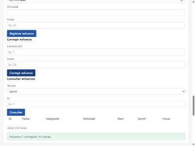

# Evidencia TDD · HU-28

> Issue del repositorio: #46

## Historia

Como Product Builder, quiero corregir un registro de esfuerzo cargado por error, para que los datos sean confiables.

## Resultado

Se agregó `CorrectHours(id, hours)` al `Manager` de `internal/effort`, con el error nuevo `ErrEffortNotFound`; `GetByID` y `Update` en los repositorios de esfuerzos de memoria y PostgreSQL; el endpoint `PATCH /api/esfuerzos/{id}/horas`; y el formulario "Corregir esfuerzo" en la sección "Sprints". Se corrigen solo las horas, con la validación de HU-26, y solo en sprints `ABIERTO`, dentro de `WithOpenSprint`. Las métricas M5 a M7, la consulta de esfuerzos y los reportes reflejan la corrección sin cambios en `internal/metrics` ni en `internal/report`.

## Trazabilidad

| Criterio | Escenarios BDD | Tests |
|---|---|---|
| CA-28.1 — corregir las horas; los demás campos no cambian | "Corregir las horas de un esfuerzo de un sprint abierto"; "Las horas con decimales se guardan sin redondear"; "Corregir con las mismas horas es válido" | `TestCorrectHours_Exitoso`; `TestCorrectHours_HorasFraccionadas`; `TestCorrectHours_MismasHoras`; `TestCorrectHours_HistoriaReasignada`; `TestCorrectHours_CopiaIndependiente`; `TestCorregirEsfuerzo_Devuelve200ConElEsfuerzoCorregido` |
| CA-28.2 — misma validación de horas que HU-26 | Esquema "Las horas corregidas se validan como al registrar" (5 ejemplos); "Las horas inválidas se informan antes que un esfuerzo inexistente" | `TestCorrectHours_HorasInvalidas`; `TestCorrectHours_OrdenDeLosErrores`; `TestCorregirEsfuerzo_HorasInvalidasDevuelve400`; `TestCorregirEsfuerzo_JSONInvalidoDevuelve400` |
| CA-28.3 — no se corrige en un sprint cerrado | "No se corrigen esfuerzos de un sprint cerrado" | `TestCorrectHours_SprintCerrado`; `TestCorregirEsfuerzo_SprintCerradoDevuelve409` |
| CA-28.4 — esfuerzo inexistente devuelve error | Esquema "Corregir un esfuerzo inexistente falla" (3 ejemplos) | `TestCorrectHours_EsfuerzoInexistente`; `TestCorrectHours_ErrorDelRepositorio`; `TestCorrectHours_ErrorEnLaSegundaLecturaSePropaga`; `TestCorregirEsfuerzo_InexistenteDevuelve404` |
| CA-28.5 — horas reales, desviación, consulta y reportes reflejan la corrección | "Las horas reales del sprint reflejan la corrección" | `TestCorrectHours_ReflejaLasHorasRealesDelSprint`; `TestCorregirEsfuerzo_LasMetricasYLaConsultaReflejanLaCorreccion`; prueba de punta a punta |
| CA-28.6 — memoria y PostgreSQL con el mismo comportamiento | — (test de contrato) | 5 subtests nuevos de `runRepositoryContract` (`GetByID` existente e inexistente, `Update` existente e inexistente, copias), que corren en `TestMemoryRepository_Contrato` y, con `TEST_DATABASE_URL`, en `TestPostgresRepository_Contrato` |
| CA-28.7 — API e interfaz | — (solo HTTP e interfaz) | `TestCorregirEsfuerzo_IDNoNumericoDevuelve400`; `TestCorregirEsfuerzo_ErrorDelRepositorioDevuelve500SinDetalle`; fila "corregir esfuerzo" de `TestRutasConID_IDNoNumericoDevuelve400`; `TestInterfaz_FormularioCorregirEsfuerzoEnSprints`; `TestInterfaz_CorregirEsfuerzoLlamaALaAPI`; prueba en el navegador |

La correspondencia no es 1 a 1: varios tests cubren más de un criterio, y CA-28.6 y CA-28.7 se verifican sin escenarios godog.

## Conteos

```text
$ grep -cE '^[[:space:]]*Escenario:' features/HU-28-corregir-esfuerzo.feature
6
$ grep -cE '^[[:space:]]*Esquema del escenario:' features/HU-28-corregir-esfuerzo.feature
2
$ grep -c '^func Test' internal/effort/correct_test.go
12
$ grep -c '^func Test' internal/effort/correct_features_test.go
1
$ grep -c '^func Test' internal/httpapi/efforts_correct_test.go
8
$ git diff --unified=0 fadf68b dade10f -- internal/httpapi/web_test.go | grep -c '^+func Test'
2
```

**23 funciones `Test` nuevas** (12 de dominio, 1 runner de godog, 8 de API y 2 de interfaz; una de dominio se agregó después del GREEN, ver "Desvíos") y **6 subtests nuevas** (5 en el contrato del repositorio y la fila de `TestRutasConID_IDNoNumericoDevuelve400`), que cubren **6 escenarios y 2 esquemas** BDD. Godog expande los esquemas (5 y 3 ejemplos) en **14 casos**.

## Fase RED (`dade10f`)

Firmas vacías: `ErrEffortNotFound`, `GetByID` y `Update` en la interfaz `effort.Repository` y en los repositorios de memoria y PostgreSQL (devuelven `Effort{}, nil`), `CorrectHours` (devuelve `Effort{}, nil`) y los dos métodos nuevos en los dobles que implementan la interfaz entera (`failingEffortRepository` y `brokenEffortRepository`, que devuelven su mismo error). La ruta, el handler y la interfaz van en el GREEN.

Antes del RED se trajo `main` con HU-19 (`44fefff`, sin conflictos) y `go test ./...` pasó en los 14 paquetes.

Salida de `go vet ./...` (sin salida) y de `go test -count=1 ./...` sobre el RED, con los tiempos recortados:

```text
ok   seguimiento-medicion-gpc/cmd/server
ok   seguimiento-medicion-gpc/internal/backlog
ok   seguimiento-medicion-gpc/internal/dashboard
ok   seguimiento-medicion-gpc/internal/defect
--- FAIL: TestFeatures_HU28CorregirEsfuerzo
--- FAIL: TestCorrectHours_Exitoso
--- FAIL: TestCorrectHours_HorasFraccionadas
--- FAIL: TestCorrectHours_MismasHoras
--- FAIL: TestCorrectHours_HorasInvalidas
--- FAIL: TestCorrectHours_SprintCerrado
--- FAIL: TestCorrectHours_EsfuerzoInexistente
--- FAIL: TestCorrectHours_OrdenDeLosErrores
--- FAIL: TestCorrectHours_HistoriaReasignada
--- FAIL: TestCorrectHours_CopiaIndependiente
--- FAIL: TestCorrectHours_ReflejaLasHorasRealesDelSprint
--- FAIL: TestCorrectHours_ErrorDelRepositorio
--- FAIL: TestMemoryRepository_Contrato
    --- FAIL: TestMemoryRepository_Contrato/GetByID_devuelve_el_esfuerzo_guardado
    --- FAIL: TestMemoryRepository_Contrato/GetByID_de_un_esfuerzo_inexistente_devuelve_ErrEffortNotFound
    --- FAIL: TestMemoryRepository_Contrato/Update_reemplaza_el_esfuerzo_y_lo_devuelve
    --- FAIL: TestMemoryRepository_Contrato/Update_de_un_esfuerzo_inexistente_devuelve_ErrEffortNotFound_sin_crear_nada
    --- FAIL: TestMemoryRepository_Contrato/GetByID_y_Update_devuelven_copias
FAIL seguimiento-medicion-gpc/internal/effort
--- FAIL: TestCorregirEsfuerzo_Devuelve200ConElEsfuerzoCorregido
--- FAIL: TestCorregirEsfuerzo_HorasInvalidasDevuelve400
--- FAIL: TestCorregirEsfuerzo_JSONInvalidoDevuelve400
--- FAIL: TestCorregirEsfuerzo_IDNoNumericoDevuelve400
--- FAIL: TestCorregirEsfuerzo_InexistenteDevuelve404
--- FAIL: TestCorregirEsfuerzo_SprintCerradoDevuelve409
--- FAIL: TestCorregirEsfuerzo_LasMetricasYLaConsultaReflejanLaCorreccion
--- FAIL: TestCorregirEsfuerzo_ErrorDelRepositorioDevuelve500SinDetalle
--- FAIL: TestRutasConID_IDNoNumericoDevuelve400
    --- FAIL: TestRutasConID_IDNoNumericoDevuelve400/corregir_esfuerzo
--- FAIL: TestInterfaz_FormularioCorregirEsfuerzoEnSprints
--- FAIL: TestInterfaz_CorregirEsfuerzoLlamaALaAPI
FAIL seguimiento-medicion-gpc/internal/httpapi
ok   seguimiento-medicion-gpc/internal/member
ok   seguimiento-medicion-gpc/internal/metrics      (repetido con GOTMPDIR, ver "Desvíos")
ok   seguimiento-medicion-gpc/internal/poker
ok   seguimiento-medicion-gpc/internal/postgres
ok   seguimiento-medicion-gpc/internal/postgrestest
ok   seguimiento-medicion-gpc/internal/project
ok   seguimiento-medicion-gpc/internal/report
ok   seguimiento-medicion-gpc/internal/sprint
?    seguimiento-medicion-gpc/internal/web [no test files]
```

Fallan **24 tests de primer nivel, todos de HU-28**: **13 en `internal/effort`** (el runner de godog, los 11 `TestCorrectHours_*` del RED y `TestMemoryRepository_Contrato`, solo por sus 5 subtests nuevos) y **11 en `internal/httpapi`** (los 8 `TestCorregirEsfuerzo_*`, los 2 de interfaz y `TestRutasConID_IDNoNumericoDevuelve400`, solo por su fila `corregir_esfuerzo`). El conteo sale de la salida completa: `grep -c '^--- FAIL:'` da 24 y `grep -ciE 'build failed|undefined:|cannot use|\[setup failed\]|panic'` da 0. Todos los fallos son de aserción: los stubs devuelven `Effort{}` y `nil`, la ruta todavía no existe (404) y el formulario no está.

Godog de HU-28 en el RED: `14 scenarios (14 failed)`, `84 steps (58 passed, 14 failed, 12 skipped)`, un paso fallido por escenario y ningún paso sin definir. HU-26 (`20 scenarios (20 passed)`) y HU-27 (`11 scenarios (11 passed)`) siguieron en verde.

## Fase GREEN (`2f947fd`)

- `internal/effort/correct.go`: `CorrectHours` valida las horas con `validHours` (`ErrInvalidHours`), busca el esfuerzo con `GetByID` (`ErrEffortNotFound`) y entra a `WithOpenSprint` del sprint del esfuerzo (`ErrSprintClosed`). Con el mutex del sprint tomado vuelve a leer el esfuerzo, cambia solo las horas y llama a `Update` (RN-28.5).
- `internal/effort/memory_repository.go` y `postgres_repository.go`: `GetByID` y `Update`, con el patrón de `internal/defect` (HU-30). En PostgreSQL, `pgx.ErrNoRows` se traduce a `ErrEffortNotFound` y la fecha se normaliza a UTC con `scanEffort`.
- `internal/httpapi/efforts.go`: `effortHoursRequest` y el handler `correctEffortHours`; las horas ausentes o no numéricas dan `ErrInvalidHours`, como en HU-26.
- `internal/httpapi/server.go`: la ruta `PATCH /api/esfuerzos/{id}/horas` y `ErrEffortNotFound` en el 404 de `statusFor`.
- `internal/web/index.html` y `app.js`: el formulario "Corregir esfuerzo", entre "Registrar esfuerzo" y "Consultar esfuerzos", con el mensaje en `msg-sprints`.

El GREEN no modifica tests ni el `.feature`:

```text
$ git diff --stat dade10f 2f947fd -- '*_test.go' '*.feature'
(sin salida)
```

Salida del GREEN: `gofmt -l ./cmd ./internal` y `go vet ./...` sin salida; `go test -count=1 ./...` con los 15 paquetes en `ok` e `internal/web [no test files]`; godog de HU-28 con `14 scenarios (14 passed)` y `84 steps (84 passed)`. `go tool cover -func` mostró `CorrectHours` en 93.8% (la rama de error de la segunda lectura, sin test), `validHours`, `GetByID` y `Update` de memoria y `correctEffortHours` en 100.0%.

## Test agregado después del GREEN (`841cfc0`)

**Desviación del ciclo TDD:** `TestCorrectHours_ErrorEnLaSegundaLecturaSePropaga` se agregó después del GREEN. Al revisar `go tool cover -func` antes del commit del GREEN, `CorrectHours` quedó en 93.8%: la rama de error de la segunda lectura del esfuerzo, la que RN-28.5 pide hacer con el mutex del sprint tomado, no tenía test. El código ya estaba en el GREEN, así que el test pasa desde el primer intento y no tuvo RED propio; no se tocó producción. Se registra como desviación, según la acción 2 de la Retrospectiva del Sprint 3, como hizo HU-33.

El test usa un doble (`secondReadFailingRepository`) que delega en el repositorio en memoria, falla solo en el segundo `GetByID` y cuenta las llamadas a `Update`. Verifica que `CorrectHours` devuelve ese error, el valor cero, 2 lecturas y 0 llamadas a `Update`, y que el esfuerzo guardado no cambia.

```text
$ go test -count=1 -run TestCorrectHours_ErrorEnLaSegundaLecturaSePropaga -v ./internal/effort/
=== RUN   TestCorrectHours_ErrorEnLaSegundaLecturaSePropaga
--- PASS: TestCorrectHours_ErrorEnLaSegundaLecturaSePropaga (0.00s)
ok      seguimiento-medicion-gpc/internal/effort
$ go tool cover -func=cover.out | grep correct.go
internal/effort/correct.go:14:  CorrectHours    100.0%
internal/effort/correct.go:43:  validHours      100.0%
```

## Prueba en el navegador y de punta a punta

Con el servidor en memoria (`PORT=8092 go run ./cmd/server`, sin `DATABASE_URL`): un proyecto, un ítem con 10 horas estimadas, un sprint abierto, el ítem asignado y dos esfuerzos (12 h de Ana y 5 h de Luis). Salidas reales de `curl`:

```text
GET /api/sprints/1/metricas (antes)   "horas_estimadas":10  "horas_reales":17  "desviacion_horas":7
PATCH /api/esfuerzos/1/horas {"horas":10}
HTTP/1.1 200 OK
{"id":1,"sprint_id":1,"item_id":1,"integrante":"Ana","fecha":"2026-10-28","actividad":"Desarrollo","horas":10}
PATCH /api/esfuerzos/1/horas {"horas":0}
HTTP/1.1 400 Bad Request
{"error":"las horas trabajadas deben ser un número positivo"}
PATCH /api/esfuerzos/99/horas {"horas":10}
HTTP/1.1 404 Not Found
{"error":"no existe un esfuerzo con ese id"}
GET /api/sprints/1/metricas (después) "horas_estimadas":10  "horas_reales":15  "desviacion_horas":5
GET /api/sprints/1/esfuerzos          …"horas":10…"horas":5…,"total_horas":15
```

En la interfaz, el formulario "Corregir esfuerzo" con el esfuerzo 2 y 4.5 horas mostró "Esfuerzo 2 corregido: 4.5 horas." en `msg-sprints` y vació el formulario; `GET /api/sprints/1/esfuerzos` dio `total_horas` 14.5 (texto leído del DOM y de la API). Después de cerrar el sprint (`POST /api/sprints/1/cerrar`, 200), `PATCH /api/esfuerzos/1/horas {"horas":8}` respondió `HTTP/1.1 409 Conflict` con `{"error":"el sprint está cerrado"}` y el total siguió en 14.5.



## Cobertura

Medición local sin base, en Windows con go1.27.2, `go test -count=1 -p 1 -coverprofile=cover.out ./...` y `go tool cover -func=cover.out`, con `GOTMPDIR` (ver "Desvíos"), sobre `841cfc0` y en `main` (`ca93bb9`) con el mismo Go y los mismos comandos, en una copia temporal con `git worktree`:

| Paquete | Rama | `main` (`ca93bb9`) |
|---|---|---|
| `cmd/server` | 48.6% | 48.6% |
| `internal/backlog` | 79.9% | 79.9% |
| `internal/dashboard` | 100.0% | 100.0% |
| `internal/defect` | 74.6% | 74.6% |
| `internal/effort` | 70.5% | 71.6% |
| `internal/httpapi` | 98.6% | 98.5% |
| `internal/member` | 60.7% | 60.7% |
| `internal/metrics` | 100.0% | 100.0% |
| `internal/poker` | 72.5% | 72.5% |
| `internal/postgres` | 83.3% | 83.3% |
| `internal/postgrestest` | 36.8% | 36.8% |
| `internal/project` | 71.1% | 71.1% |
| `internal/report` | 100.0% | 100.0% |
| `internal/sprint` | 73.9% | 73.9% |
| **Total del perfil** | **84.0%** | **84.2%** |

`CorrectHours`, `validHours`, `GetByID` y `Update` de memoria y `correctEffortHours` quedan en 100.0%. `internal/effort` baja de 71.6% a 70.5% y el total de 84.2% a 84.0% porque `GetByID` y `Update` de PostgreSQL (0.0%) no se ejecutan sin base: sus casos del contrato se omiten sin `TEST_DATABASE_URL` (7 tests de PostgreSQL omitidos en `internal/effort`). `internal/httpapi` sube de 98.5% a 98.6%. No se midió con PostgreSQL: el motor de Docker no se levantó; el contrato de `GetByID` y `Update` corre igual en el CI cuando hay base, y queda para otro integrante con la base disponible.

## Desvíos y límites

1. **Test agregado después del GREEN.** `841cfc0` (ver la sección anterior): la rama de error de la segunda lectura de `CorrectHours` no tenía test en el RED.
2. **Fila fallando en un test existente en el RED.** `TestRutasConID_IDNoNumericoDevuelve400` quedó en el RED con la fila "corregir esfuerzo" fallando (404 en lugar de 400, porque la ruta todavía no existía); las demás filas pasaron, y en el GREEN pasa completo.
3. **Ejecutables de prueba bloqueados por Windows.** En este equipo, "An Application Control policy has blocked this file" bloqueó al azar algunos ejecutables de prueba (`internal/metrics` en el RED; `cmd/server` e `internal/httpapi` en el GREEN). No son fallos de los tests: con `GOTMPDIR` en otra carpeta, y repitiendo cuando hizo falta, dieron `ok`. HU-24 ya registró el mismo problema en `cobertura.md`.
4. **Orden de los commits.** El merge de `main` (`44fefff`) quedó antes del commit de la aprobación de la SDD (`fadf68b`); el contenido es el mismo.
5. **Límites conocidos de la SDD.** Solo se corrigen las horas: un integrante mal escrito ("ana" en lugar de "Ana") no se puede corregir con esta historia. No queda historial de las correcciones, y dos correcciones simultáneas del mismo esfuerzo no se pisan a mitad de camino, pero gana la última.
6. **`-race`.** No se corrió localmente (`CGO_ENABLED=0`); lo corre el CI.

## Commits

| Fase | Commit | Mensaje |
|---|---|---|
| SDD | `198d5f0` | `docs(HU-28): agregar especificación SDD` |
| Merge de `main` | `44fefff` | `chore(HU-28): traer main con HU-15 y HU-19` |
| Aprobación de la SDD | `fadf68b` | `docs(HU-28): registrar la aprobación de la SDD` |
| RED | `dade10f` | `test(HU-28): agregar tests (RED)` |
| GREEN | `2f947fd` | `feat(HU-28): corregir las horas de un esfuerzo (GREEN)` |
| Test posterior al GREEN | `841cfc0` | `test(HU-28): agregar test de la falla en la segunda lectura` |
| Refactor | No hubo | — |

HU-28: Historia → SDD → Criterios de Aceptación → BDD → Tests → Código Go
