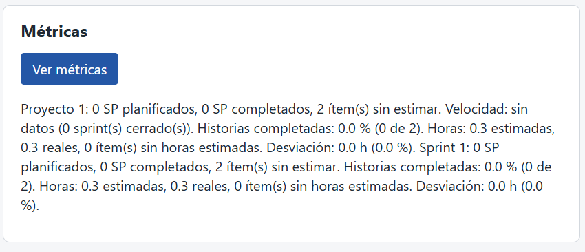

# Evidencia TDD · HU-33

> Issue del repositorio: #51

## Historia

Como Agile Enabler, quiero calcular las horas estimadas, las horas reales y la desviación entre ambas, para mejorar las estimaciones futuras.

## Resultado

Se implementaron M4 a M7 en el dominio para sprints y proyectos, se extendieron `GET /api/sprints/{id}/metricas` y `GET /api/proyectos/{id}/metricas`, y se añadieron las horas y la desviación a la sección Métricas de la interfaz. El dominio conserva los `float64` sin redondear; la API redondea a un decimal y normaliza el cero negativo, y la interfaz muestra un decimal o "sin datos".

El GREEN quedó en `56b151b` y se integró `origin/main` mediante el merge commit `cfeb9d2`.

## Trazabilidad

| Criterio | Escenarios BDD | Tests y verificación |
|---|---|---|
| CA-33.1 — M4 suma las horas estimadas y cuenta ítems con cero | "Horas y desviación de un sprint con el ejemplo de TEC-03"; "El proyecto suma todo el backlog y los esfuerzos de sus sprints" | `TestSprintHours_EjemploDeTEC03`; `TestProjectHours_SumaTodoElBacklogYLosEsfuerzos`; `TestMetricasSprint_IncluyeHorasYDesviacion`; `TestMetricasProyecto_IncluyeTodoElBacklogYLosEsfuerzos` |
| CA-33.2 — M5 suma los esfuerzos del sprint consultado | "Horas y desviación de un sprint con el ejemplo de TEC-03"; "Un sprint solo suma sus propios esfuerzos" | `TestSprintHours_EjemploDeTEC03`; `TestSprintHours_SoloSumaLosEsfuerzosDelSprint`; `TestMetricasSprint_IncluyeHorasYDesviacion` |
| CA-33.3 — M6 y M7 aplican las fórmulas y se presentan con un decimal | "Horas y desviación de un sprint con el ejemplo de TEC-03"; "El proyecto suma todo el backlog y los esfuerzos de sus sprints" | `TestMetricas_RedondeaHorasYDesviacionAUnDecimal`; `TestMetricasSprint_IncluyeHorasYDesviacion`; `TestMetricasProyecto_IncluyeTodoElBacklogYLosEsfuerzos` |
| CA-33.4 — sin M4 o M5, la desviación no está disponible | "Un sprint sin ítems no tiene desviación"; "Un proyecto sin ítems no tiene desviación"; "Sin horas estimadas la desviación no está disponible"; "Sin esfuerzos la desviación no está disponible" | `TestSprintHours_SinItems`; `TestProjectHours_SinItems`; `TestSprintHours_SinHorasEstimadasNoEstaDisponible`; `TestSprintHours_SinEsfuerzosNoEstaDisponible`; `TestMetricas_SinDatosLaDesviacionEsNull` |
| CA-33.5 — exponer las métricas en ambos endpoints y la interfaz | Los endpoints y la interfaz se verifican con tests HTTP/web y con la prueba de punta a punta de esta evidencia | `TestMetricasSprint_IncluyeHorasYDesviacion`; `TestMetricasProyecto_IncluyeTodoElBacklogYLosEsfuerzos`; `TestInterfaz_MetricasMuestraHorasYDesviacion`; `TestInterfaz_Numero1NormalizaElCeroNegativo` |
| CA-33.6 — M4 de proyecto incluye todo el backlog y M5 sus sprints | "El proyecto suma todo el backlog y los esfuerzos de sus sprints" | `TestProjectHours_SumaTodoElBacklogYLosEsfuerzos`; `TestMetricasProyecto_IncluyeTodoElBacklogYLosEsfuerzos` |
| CA-33.7 — sprint y proyecto vacíos devuelven cero, sin desviación | "Un sprint sin ítems no tiene desviación"; "Un proyecto sin ítems no tiene desviación" | `TestSprintHours_SinItems`; `TestProjectHours_SinItems`; `TestMetricas_SinDatosLaDesviacionEsNull` |
| CA-33.8 — errores, solo lectura y propagación del repositorio | Dos esquemas: "Consultar un sprint inexistente falla" y "Consultar un proyecto inexistente falla" (3 ejemplos cada uno); "Consultar las métricas no modifica los datos" | `TestSprintHours_SprintInexistenteDevuelveErrSprintNotFound`; `TestProjectHours_ProyectoInexistenteDevuelveErrProjectNotFound`; `TestHours_ErrorDelRepositorioDeEsfuerzosSePropaga`; `TestHours_NoModificaNada`; `TestMetricas_ErrorDelRepositorioDeEsfuerzosDevuelve500` |
| CA-33.9 — dominio sin redondeo, presentación a un decimal y cero negativo normalizado | El ejemplo TEC-03 y las consultas de métricas; el caso decimal se verifica además por test y navegador | `TestSprintHours_ElDominioNoRedondea`; `TestMetricas_RedondeaHorasYDesviacionAUnDecimal`; `TestMetricas_NormalizaElCeroNegativo`; `TestInterfaz_Numero1NormalizaElCeroNegativo`; captura manual incluida abajo |
| CA-33.10 — resultado por valor, sin mutar el estado guardado | "Consultar las métricas no modifica los datos" | `TestSprintHours_DevuelveUnaCopiaPorValor`; `TestHours_NoModificaNada` |

La cobertura no es 1:1: hay escenarios que satisfacen más de un criterio, y API/interfaz se validan con tests Go y recorridos HTTP adicionales.

## Conteos

Conteos de bloques Gherkin y funciones de test, obtenidos ahora con `grep` en Git Bash:

```text
$ grep -cE '^[[:space:]]*Escenario:' features/HU-33-horas-desviacion.feature
8
$ grep -cE '^[[:space:]]*Esquema del escenario:' features/HU-33-horas-desviacion.feature
2
$ grep -c '^func Test' internal/metrics/hours_test.go
13
$ grep -c '^func Test' internal/metrics/hours_features_test.go
1
$ grep -c '^func Test' internal/httpapi/metrics_test.go
15
$ grep -c '^func Test' internal/httpapi/web_test.go
27
```

Los cuatro archivos contienen 56 funciones `Test` en total; el conteo incluye tests anteriores de HU-32 y otras historias. Las funciones añadidas por RED, contadas con `git diff --unified=0 59f2a0e 6f69314 -- <archivo> | grep -c '^+func Test'`, fueron 13 en `hours_test.go`, 1 runner en `hours_features_test.go`, 6 en `metrics_test.go` y 2 en `web_test.go`: 22 funciones nuevas. Godog expande los 8 escenarios y 2 esquemas en 14 casos (los esquemas tienen 3 ejemplos cada uno).

Ejecución actual de Godog:

```text
$ go test -count=1 -v -run TestFeatures_HU33CalcularHorasDesviacion ./internal/metrics
14 scenarios (14 passed)
84 steps (84 passed)
--- PASS: TestFeatures_HU33CalcularHorasDesviacion
ok      seguimiento-medicion-gpc/internal/metrics       0.499s
```

## Fase RED

| Fase | Commit | Mensaje |
|---|---|---|
| SDD | `59f2a0e` | `docs(HU-33): agregar la especificación (SDD)` |
| RED | `6f69314` | `test(HU-33): agregar tests (RED)` |

Reproducción ejecutada ahora en un worktree temporal detached en `6f69314`, con:

```text
$ go test -count=1 ./...
```

La salida tuvo 19 líneas de fallo de tests de primer nivel y cero marcadores de compilación o setup. El conteo se obtuvo de la salida completa con `grep -c '^--- FAIL:'` (19) y `grep -ciE 'build failed|undefined:|cannot use|\[setup failed\]'` (0). Los fallos fueron aserciones: los stubs devolvían métricas vacías, errores `nil` donde se esperaban errores de entidad/repositorio, la API devolvía ceros o campos nulos y la interfaz todavía no mostraba los campos.

La salida del runner HU-33 en RED fue:

```text
14 scenarios (3 passed, 11 failed)
84 steps (56 passed, 11 failed, 17 skipped)
```

Las otras 16 scenarios de HU-32 pasaron. La ejecución terminó en fallo por los tests de `internal/httpapi` e `internal/metrics`, no por compilación.

### Ajustes de tests previos al GREEN

- `71c5b68`: `TestSprintHours_ElDominioNoRedondea` esperaba `0.3` porque en Go `0.1+0.2` entre constantes da exactamente `0.3`, mientras que la suma en ejecución da `0.30000000000000004`, valor esperado por la SDD. Se corrigió el test en un commit aparte antes del GREEN para comparar con la suma en ejecución.
- `c17fa06`: el RED agregó `ItemsSinHorasEstimadas` al tipo `sprintMetricsJSON`; el test de HU-32 compara structs completos, así que su expectativa implícita pasó a ser `0`. Se ajustó a `4`, el valor correspondiente a sus cuatro ítems sin horas estimadas, en un commit aparte antes del GREEN.
- `3585be5`: el test del RED buscaba "horas estimadas" y "Desviación" en `index.html`, pero la SDD pone esos textos en `app.js` y en `index.html` define otra frase. Se alineó el test con la SDD en un commit aparte antes del GREEN.

## Fase GREEN

| Fase | Commit | Mensaje |
|---|---|---|
| GREEN | `56b151b` | `feat(HU-33): calcular horas estimadas, reales y desviación (GREEN)` |
| Merge de `main` | `cfeb9d2` | Merge normal de `origin/main`, sin rebase ni squash |

## Verificación manual en navegador

La captura [cero-negativo.png](img/HU-33/cero-negativo.png) muestra el proyecto y el sprint con 0.1 y 0.2 horas estimadas y 0.3 horas reales; la desviación aparece como `0.0 h (0.0 %)`, no `-0.0`. También quedó visible el aviso de selección de proyecto de la sección Backlog porque los datos se crearon por `curl`; no afecta las métricas consultadas.



## Prueba de punta a punta de la API

El servidor real se ejecutó en memoria en el puerto 18080 para no alterar la sesión manual del puerto 8080. Go fue `go1.27.2 windows/amd64`; el módulo declara Go 1.27.1. Los pedidos `curl` se ejecutaron en Git Bash.

### Cero negativo: 0.1, 0.2 y 0.3

```text
$ curl -s -w '\nHTTP %{http_code}\n' -X POST http://localhost:18080/api/proyectos -d '{"nombre":"Cero negativo"}'
{"id":1,"nombre":"Cero negativo","descripcion":"","estado":"PLANIFICADO","fecha_inicio":""}
HTTP 201
$ curl -s -w '\nHTTP %{http_code}\n' -X POST http://localhost:18080/api/proyectos/1/backlog -d '{"titulo":"Item A","descripcion":"","prioridad":"alta","criterios":["c"]}'
{"id":1,"proyecto_id":1,"titulo":"Item A","descripcion":"","prioridad":"ALTA","criterios":["c"],"estado":"PENDIENTE","story_points":0,"horas_estimadas":0,"sprint_id":0}
HTTP 201
$ curl -s -w '\nHTTP %{http_code}\n' -X POST http://localhost:18080/api/proyectos/1/backlog -d '{"titulo":"Item B","descripcion":"","prioridad":"alta","criterios":["c"]}'
{"id":2,"proyecto_id":1,"titulo":"Item B","descripcion":"","prioridad":"ALTA","criterios":["c"],"estado":"PENDIENTE","story_points":0,"horas_estimadas":0,"sprint_id":0}
HTTP 201
$ curl -s -w '\nHTTP %{http_code}\n' -X PUT http://localhost:18080/api/items/1 -d '{"titulo":"Item A","descripcion":"","prioridad":"alta","criterios":["c"],"horas_estimadas":0.1}'
{"id":1,"proyecto_id":1,"titulo":"Item A","descripcion":"","prioridad":"ALTA","criterios":["c"],"estado":"PENDIENTE","story_points":0,"horas_estimadas":0.1,"sprint_id":0}
HTTP 200
$ curl -s -w '\nHTTP %{http_code}\n' -X PUT http://localhost:18080/api/items/2 -d '{"titulo":"Item B","descripcion":"","prioridad":"alta","criterios":["c"],"horas_estimadas":0.2}'
{"id":2,"proyecto_id":1,"titulo":"Item B","descripcion":"","prioridad":"ALTA","criterios":["c"],"estado":"PENDIENTE","story_points":0,"horas_estimadas":0.2,"sprint_id":0}
HTTP 200
$ curl -s -w '\nHTTP %{http_code}\n' -X POST http://localhost:18080/api/proyectos/1/sprints -d '{"nombre":"Sprint 1","fecha_inicio":"2026-10-27","fecha_fin":"2026-11-02","objetivo":"Probar el cero negativo"}'
{"id":1,"proyecto_id":1,"nombre":"Sprint 1","fecha_inicio":"2026-10-27","fecha_fin":"2026-11-02","objetivo":"Probar el cero negativo","estado":"ABIERTO"}
HTTP 201
$ curl -s -w '\nHTTP %{http_code}\n' -X POST http://localhost:18080/api/sprints/1/items/1
{"id":1,"proyecto_id":1,"titulo":"Item A","descripcion":"","prioridad":"ALTA","criterios":["c"],"estado":"PENDIENTE","story_points":0,"horas_estimadas":0.1,"sprint_id":1}
HTTP 200
$ curl -s -w '\nHTTP %{http_code}\n' -X POST http://localhost:18080/api/sprints/1/items/2
{"id":2,"proyecto_id":1,"titulo":"Item B","descripcion":"","prioridad":"ALTA","criterios":["c"],"estado":"PENDIENTE","story_points":0,"horas_estimadas":0.2,"sprint_id":1}
HTTP 200
$ curl -s -w '\nHTTP %{http_code}\n' -X POST http://localhost:18080/api/sprints/1/items/1/esfuerzos -d '{"integrante":"Santiago","fecha":"2026-10-28","actividad":"Prueba","horas":0.3}'
{"id":1,"sprint_id":1,"item_id":1,"integrante":"Santiago","fecha":"2026-10-28","actividad":"Prueba","horas":0.3}
HTTP 201
$ curl -s -w '\nHTTP %{http_code}\n' http://localhost:18080/api/sprints/1/metricas
{"sprint_id":1,"sp_planificados":0,"sp_completados":0,"items_sin_estimar":2,"items_totales":2,"items_terminados":0,"porcentaje_completadas":0,"horas_estimadas":0.3,"horas_reales":0.3,"desviacion_horas":0,"desviacion_porcentual":0,"items_sin_horas_estimadas":0}
HTTP 200
$ curl -s -w '\nHTTP %{http_code}\n' http://localhost:18080/api/proyectos/1/metricas
{"proyecto_id":1,"sp_planificados":0,"sp_completados":0,"items_sin_estimar":2,"velocidad":null,"sprints_cerrados":0,"items_totales":2,"items_terminados":0,"porcentaje_completadas":0,"horas_estimadas":0.3,"horas_reales":0.3,"desviacion_horas":0,"desviacion_porcentual":0,"items_sin_horas_estimadas":0}
HTTP 200
```

### Ejemplo TEC-03

```text
$ curl -s -w '\nHTTP %{http_code}\n' -X POST http://localhost:18080/api/proyectos/1 -d '{"nombre":"Sistema de ventas"}'
{"id":1,"nombre":"Sistema de ventas","descripcion":"","estado":"PLANIFICADO","fecha_inicio":""}
HTTP 201
$ curl -s -w '\nHTTP %{http_code}\n' -X POST http://localhost:18080/api/proyectos/1/backlog -d '{"titulo":"A","descripcion":"","prioridad":"alta","criterios":["c"]}'
{"id":1,"proyecto_id":1,"titulo":"A","descripcion":"","prioridad":"ALTA","criterios":["c"],"estado":"PENDIENTE","story_points":0,"horas_estimadas":0,"sprint_id":0}
HTTP 201
$ curl -s -w '\nHTTP %{http_code}\n' -X PUT http://localhost:18080/api/items/1 -d '{"titulo":"A","descripcion":"","prioridad":"alta","criterios":["c"],"horas_estimadas":10}'
{"id":1,"proyecto_id":1,"titulo":"A","descripcion":"","prioridad":"ALTA","criterios":["c"],"estado":"PENDIENTE","story_points":0,"horas_estimadas":10,"sprint_id":0}
HTTP 200
$ curl -s -w '\nHTTP %{http_code}\n' -X POST http://localhost:18080/api/proyectos/1/backlog -d '{"titulo":"B","descripcion":"","prioridad":"alta","criterios":["c"]}'
{"id":2,"proyecto_id":1,"titulo":"B","descripcion":"","prioridad":"ALTA","criterios":["c"],"estado":"PENDIENTE","story_points":0,"horas_estimadas":0,"sprint_id":0}
HTTP 201
$ curl -s -w '\nHTTP %{http_code}\n' -X PUT http://localhost:18080/api/items/2 -d '{"titulo":"B","descripcion":"","prioridad":"alta","criterios":["c"],"horas_estimadas":6}'
{"id":2,"proyecto_id":1,"titulo":"B","descripcion":"","prioridad":"ALTA","criterios":["c"],"estado":"PENDIENTE","story_points":0,"horas_estimadas":6,"sprint_id":0}
HTTP 200
$ curl -s -w '\nHTTP %{http_code}\n' -X POST http://localhost:18080/api/proyectos/1/backlog -d '{"titulo":"C","descripcion":"","prioridad":"alta","criterios":["c"]}'
{"id":3,"proyecto_id":1,"titulo":"C","descripcion":"","prioridad":"ALTA","criterios":["c"],"estado":"PENDIENTE","story_points":0,"horas_estimadas":0,"sprint_id":0}
HTTP 201
$ curl -s -w '\nHTTP %{http_code}\n' -X PUT http://localhost:18080/api/items/3 -d '{"titulo":"C","descripcion":"","prioridad":"alta","criterios":["c"],"horas_estimadas":0}'
{"id":3,"proyecto_id":1,"titulo":"C","descripcion":"","prioridad":"ALTA","criterios":["c"],"estado":"PENDIENTE","story_points":0,"horas_estimadas":0,"sprint_id":0}
HTTP 200
$ curl -s -w '\nHTTP %{http_code}\n' -X POST http://localhost:18080/api/proyectos/1/backlog -d '{"titulo":"D","descripcion":"","prioridad":"alta","criterios":["c"]}'
{"id":4,"proyecto_id":1,"titulo":"D","descripcion":"","prioridad":"ALTA","criterios":["c"],"estado":"PENDIENTE","story_points":0,"horas_estimadas":0,"sprint_id":0}
HTTP 201
$ curl -s -w '\nHTTP %{http_code}\n' -X PUT http://localhost:18080/api/items/4 -d '{"titulo":"D","descripcion":"","prioridad":"alta","criterios":["c"],"horas_estimadas":4}'
{"id":4,"proyecto_id":1,"titulo":"D","descripcion":"","prioridad":"ALTA","criterios":["c"],"estado":"PENDIENTE","story_points":0,"horas_estimadas":4,"sprint_id":0}
HTTP 200
$ curl -s -w '\nHTTP %{http_code}\n' -X POST http://localhost:18080/api/proyectos/1/sprints -d '{"nombre":"Sprint 1","fecha_inicio":"2026-10-27","fecha_fin":"2026-11-02","objetivo":"Ejemplo TEC-03"}'
{"id":1,"proyecto_id":1,"nombre":"Sprint 1","fecha_inicio":"2026-10-27","fecha_fin":"2026-11-02","objetivo":"Ejemplo TEC-03","estado":"ABIERTO"}
HTTP 201
$ curl -s -w '\nHTTP %{http_code}\n' -X POST http://localhost:18080/api/sprints/1/items/1
{"id":1,"proyecto_id":1,"titulo":"A","descripcion":"","prioridad":"ALTA","criterios":["c"],"estado":"PENDIENTE","story_points":0,"horas_estimadas":10,"sprint_id":1}
HTTP 200
$ curl -s -w '\nHTTP %{http_code}\n' -X POST http://localhost:18080/api/sprints/1/items/2
{"id":2,"proyecto_id":1,"titulo":"B","descripcion":"","prioridad":"ALTA","criterios":["c"],"estado":"PENDIENTE","story_points":0,"horas_estimadas":6,"sprint_id":1}
HTTP 200
$ curl -s -w '\nHTTP %{http_code}\n' -X POST http://localhost:18080/api/sprints/1/items/3
{"id":3,"proyecto_id":1,"titulo":"C","descripcion":"","prioridad":"ALTA","criterios":["c"],"estado":"PENDIENTE","story_points":0,"horas_estimadas":0,"sprint_id":1}
HTTP 200
$ curl -s -w '\nHTTP %{http_code}\n' -X POST http://localhost:18080/api/sprints/1/items/4
{"id":4,"proyecto_id":1,"titulo":"D","descripcion":"","prioridad":"ALTA","criterios":["c"],"estado":"PENDIENTE","story_points":0,"horas_estimadas":4,"sprint_id":1}
HTTP 200
$ curl -s -w '\nHTTP %{http_code}\n' -X POST http://localhost:18080/api/sprints/1/items/1/esfuerzos -d '{"integrante":"Santiago","fecha":"2026-10-28","actividad":"Prueba TEC-03","horas":12}'
{"id":1,"sprint_id":1,"item_id":1,"integrante":"Santiago","fecha":"2026-10-28","actividad":"Prueba TEC-03","horas":12}
HTTP 201
$ curl -s -w '\nHTTP %{http_code}\n' -X POST http://localhost:18080/api/sprints/1/items/2/esfuerzos -d '{"integrante":"Santiago","fecha":"2026-10-28","actividad":"Prueba TEC-03","horas":5}'
{"id":2,"sprint_id":1,"item_id":2,"integrante":"Santiago","fecha":"2026-10-28","actividad":"Prueba TEC-03","horas":5}
HTTP 201
$ curl -s -w '\nHTTP %{http_code}\n' -X POST http://localhost:18080/api/sprints/1/items/3/esfuerzos -d '{"integrante":"Santiago","fecha":"2026-10-28","actividad":"Prueba TEC-03","horas":3}'
{"id":3,"sprint_id":1,"item_id":3,"integrante":"Santiago","fecha":"2026-10-28","actividad":"Prueba TEC-03","horas":3}
HTTP 201
$ curl -s -w '\nHTTP %{http_code}\n' http://localhost:18080/api/sprints/1/metricas
{"sprint_id":1,"sp_planificados":0,"sp_completados":0,"items_sin_estimar":4,"items_totales":4,"items_terminados":0,"porcentaje_completadas":0,"horas_estimadas":20,"horas_reales":20,"desviacion_horas":0,"desviacion_porcentual":0,"items_sin_horas_estimadas":1}
HTTP 200
$ curl -s -w '\nHTTP %{http_code}\n' http://localhost:18080/api/proyectos/1/metricas
{"proyecto_id":1,"sp_planificados":0,"sp_completados":0,"items_sin_estimar":4,"velocidad":null,"sprints_cerrados":0,"items_totales":4,"items_terminados":0,"porcentaje_completadas":0,"horas_estimadas":20,"horas_reales":20,"desviacion_horas":0,"desviacion_porcentual":0,"items_sin_horas_estimadas":1}
HTTP 200
```

### Validación final

Ejecutada el 28/10/2026 sobre el merge `cfeb9d2`, con `go1.27.2 windows/amd64`, sin `TEST_DATABASE_URL`.

```text
$ gofmt -l .
(sin salida; exit 0)
$ go vet ./...
(sin salida; exit 0)
$ go test ./... -count=1
ok      seguimiento-medicion-gpc/cmd/server     2.434s
ok      seguimiento-medicion-gpc/internal/backlog       1.221s
ok      seguimiento-medicion-gpc/internal/defect        2.521s
ok      seguimiento-medicion-gpc/internal/effort        1.007s
ok      seguimiento-medicion-gpc/internal/httpapi       1.858s
ok      seguimiento-medicion-gpc/internal/metrics       0.658s
ok      seguimiento-medicion-gpc/internal/poker 0.929s
ok      seguimiento-medicion-gpc/internal/postgres      0.647s
ok      seguimiento-medicion-gpc/internal/postgrestest  0.589s
ok      seguimiento-medicion-gpc/internal/project       0.872s
ok      seguimiento-medicion-gpc/internal/sprint        0.901s
?       seguimiento-medicion-gpc/internal/web   [no test files]
(exit 0)
```

## Cobertura

Medición local sin PostgreSQL:

```text
$ go --% test -count=1 -coverprofile=cover.out ./...
ok      seguimiento-medicion-gpc/cmd/server     1.119s  coverage: 50.0% of statements
ok      seguimiento-medicion-gpc/internal/backlog       1.430s  coverage: 79.9% of statements
ok      seguimiento-medicion-gpc/internal/defect        1.316s  coverage: 75.6% of statements
ok      seguimiento-medicion-gpc/internal/effort        1.314s  coverage: 71.6% of statements
ok      seguimiento-medicion-gpc/internal/httpapi       1.105s  coverage: 97.6% of statements
ok      seguimiento-medicion-gpc/internal/metrics       0.813s  coverage: 98.0% of statements
ok      seguimiento-medicion-gpc/internal/poker 1.139s  coverage: 66.2% of statements
ok      seguimiento-medicion-gpc/internal/postgres      0.727s  coverage: 83.3% of statements
ok      seguimiento-medicion-gpc/internal/postgrestest  0.699s  coverage: 36.8% of statements
ok      seguimiento-medicion-gpc/internal/project       1.080s  coverage: 63.7% of statements
ok      seguimiento-medicion-gpc/internal/sprint        1.118s  coverage: 72.8% of statements
        seguimiento-medicion-gpc/internal/web           coverage: 0.0% of statements
$ go --% tool cover -func=cover.out
seguimiento-medicion-gpc/internal/httpapi/metrics.go:43: sprintMetrics 88.2%
seguimiento-medicion-gpc/internal/httpapi/metrics.go:75: projectMetrics 90.0%
seguimiento-medicion-gpc/internal/httpapi/metrics.go:112: toHoursResponse 100.0%
seguimiento-medicion-gpc/internal/httpapi/metrics.go:127: roundOneDecimal 100.0%
seguimiento-medicion-gpc/internal/metrics/hours.go:17: SprintHours 90.0%
seguimiento-medicion-gpc/internal/metrics/hours.go:36: ProjectHours 92.3%
seguimiento-medicion-gpc/internal/metrics/hours.go:59: hoursOf 100.0%
total: (statements) 80.8%
```

La comparación se hizo en el worktree temporal `f6e8101`, con el mismo Go, entorno, comandos y sin base:

```text
$ go --% test -count=1 -coverprofile=cover.out ./...
ok      seguimiento-medicion-gpc/cmd/server     2.330s  coverage: 50.0% of statements
ok      seguimiento-medicion-gpc/internal/backlog       3.260s  coverage: 79.9% of statements
ok      seguimiento-medicion-gpc/internal/defect        2.683s  coverage: 75.6% of statements
ok      seguimiento-medicion-gpc/internal/effort        2.577s  coverage: 71.6% of statements
ok      seguimiento-medicion-gpc/internal/httpapi       1.971s  coverage: 97.5% of statements
ok      seguimiento-medicion-gpc/internal/metrics       2.208s  coverage: 100.0% of statements
ok      seguimiento-medicion-gpc/internal/poker 3.104s  coverage: 66.2% of statements
ok      seguimiento-medicion-gpc/internal/postgres      1.873s  coverage: 83.3% of statements
ok      seguimiento-medicion-gpc/internal/postgrestest  2.227s  coverage: 36.8% of statements
ok      seguimiento-medicion-gpc/internal/project       2.477s  coverage: 63.7% of statements
ok      seguimiento-medicion-gpc/internal/sprint        2.345s  coverage: 72.8% of statements
        seguimiento-medicion-gpc/internal/web           coverage: 0.0% of statements
$ go --% tool cover -func=cover.out
seguimiento-medicion-gpc/internal/httpapi/metrics.go:41: sprintMetrics 84.6%
seguimiento-medicion-gpc/internal/httpapi/metrics.go:67: projectMetrics 86.7%
seguimiento-medicion-gpc/internal/httpapi/metrics.go:90: toProjectMetricsResponse 100.0%
seguimiento-medicion-gpc/internal/httpapi/metrics.go:107: toCompletionResponse 100.0%
seguimiento-medicion-gpc/internal/metrics/manager.go:18: NewManager 100.0%
total: (statements) 80.2%
```

No se repitió la medición con PostgreSQL: `docker info` no pudo conectar con Docker Desktop y `TEST_DATABASE_URL` no estaba definido. La cobertura de integración PostgreSQL queda para otro integrante con la base disponible. La cobertura de `internal/web` es 0.0% en Go porque `Handler` es el único código Go de ese paquete y la interfaz se prueba desde `internal/httpapi`; la evidencia manual y los tests web verifican el HTML y JavaScript.

`go tool cover -func=cover.out` mostró `hoursOf`, `toHoursResponse` y `roundOneDecimal` en 100.0%; `SprintHours` en 90.0%, `ProjectHours` en 92.3%, `sprintMetrics` en 88.2% y `projectMetrics` en 90.0%. En `main` (`f6e8101`), `sprintMetrics` estaba en 84.6% y `projectMetrics` en 86.7%.

La cobertura total pasó de 80.2% en `main` (`f6e8101`) a 80.8% en la rama; `internal/httpapi` pasó de 97.5% a 97.6% e `internal/metrics` de 100.0% a 98.0%. Los otros paquetes mantuvieron los porcentajes mostrados por las dos salidas anteriores.

## Pruebas de mutación y `-race`

No hubo pruebas de mutación: la SDD excluye esa actividad para una historia de 3 SP.

```text
$ go env CGO_ENABLED
0
$ go test -race ./...
go: -race requires cgo; enable cgo by setting CGO_ENABLED=1
```

`-race` no corre localmente porque este entorno no tiene cgo. La CI corre `go test -race -coverprofile=coverage.out ./...` en `ubuntu-latest`.

HU-33: Historia → SDD → Criterios de Aceptación → BDD → Tests → Código Go
