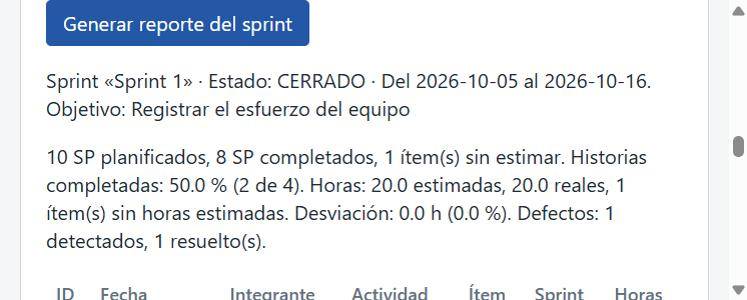
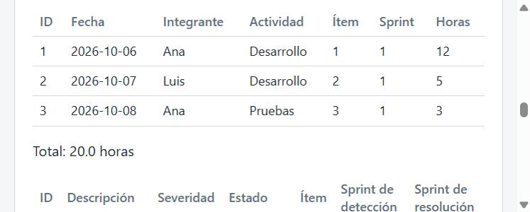
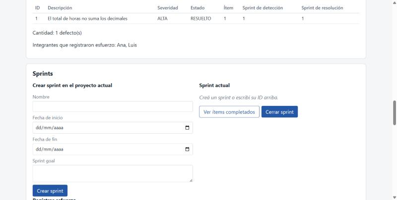

# Evidencia TDD · HU-39

> Issue del repositorio: #57

## Historia

Como Agile Enabler, quiero generar el reporte de un sprint, para documentar su resultado.

## Resultado

Se agregó la operación `Sprint(sprintID)` al `Manager` de `internal/report`, con el tipo `SprintReport`, que reutiliza `Efforts`, `Defects`, `Members` y `membersOf` de HU-38; el endpoint `GET /api/sprints/{id}/reporte`, con cada parte en el formato de una respuesta existente (`toSprintResponse`, `toSprintMetricsResponse`, `toEffortListResponse` y `toDefectListResponse`); y el botón "Generar reporte del sprint" en la sección "Reportes", con su propio contenedor. Los defectos del reporte son los detectados o resueltos en el sprint, así sus conteos coinciden con M9 y M10 (RN-39.5). No cambian `internal/metrics`, `internal/defect`, `internal/effort`, `internal/sprint` ni el reporte del proyecto.

## Trazabilidad

| Criterio | Escenarios BDD | Tests |
|---|---|---|
| CA-39.1 — datos del sprint, métricas, esfuerzos, defectos e integrantes | "El reporte del sprint del ejemplo de TEC-03 tiene todas sus partes" | `TestSprint_EjemploDeTEC03`; `TestReporteSprint_ContratoDelEjemploDeTEC03` |
| CA-39.2 — sprints abiertos y cerrados | "Un sprint abierto genera el mismo reporte que uno cerrado" | `TestSprint_SprintAbiertoYCerrado`; `TestReporteSprint_ContratoDelSprintVacio` (sprint abierto) |
| CA-39.3 — sprint inexistente devuelve error | Esquemas "Generar el reporte de un sprint inexistente falla" (3 ejemplos) y "Si falla una lectura no se hacen las siguientes" (4 ejemplos) | `TestSprint_SprintInexistenteNoLeeNadaMas`; `TestSprint_ErroresEnElOrdenDeLectura`; `TestReporteSprint_InexistenteDevuelve404` |
| CA-39.4 — sprint sin datos | "Un sprint recién creado genera el reporte con las secciones vacías"; "Un sprint con ítems y sin esfuerzos tiene las métricas y las listas vacías" | `TestSprint_SprintSinDatos`; `TestSprint_SprintConItemsYSinEsfuerzos`; `TestReporteSprint_ContratoDelSprintVacio` |
| CA-39.5 — coincidencia con las consultas, total igual a M5 y defectos iguales a M9 y M10 | "Un defecto detectado en otro sprint y resuelto en este aparece en el reporte"; "Los defectos del sprint son los detectados o resueltos en él, una sola vez cada uno"; "Cada parte del reporte es igual a su consulta de origen"; "Horas con decimales suman el total exacto, igual a las horas reales" | `TestSprint_CadaParteEsIgualASuOperacionDeOrigen`; `TestSprint_DefectosDetectadosOResueltosEnElSprint`; `TestSprint_DefectoDetectadoYResueltoEnElSprintApareceUnaVez`; `TestSprint_TotalDeHorasExactoEIgualAHorasReales`; `TestReporteSprint_CadaParteEsIgualASuEndpoint`; `TestReporteSprint_DefectoResueltoEnElSprintYDetectadoEnOtro`; `TestReporteSprint_RedondeaElTotalDeHorasAUnDecimal` |
| CA-39.6 — integrantes sin repetir y solo datos del sprint | "Solo aparecen los esfuerzos y los integrantes del sprint, cada integrante una vez" | `TestSprint_IntegrantesYEsfuerzosSoloDelSprint` |
| CA-39.7 — no modifica nada | "Generar el reporte dos veces sin cambios da el mismo resultado y no modifica nada" | `TestSprint_NoModificaNadaYDevuelveCopias` |
| CA-39.8 — API e interfaz | Solo HTTP e interfaz (ver el comentario inicial del `.feature`) | `TestReporteSprint_IDNoNumericoDevuelve400`; `TestReporteSprint_ErrorDelRepositorioDevuelve500SinDetalle`; fila "reporte del sprint" de `TestRutasConID_IDNoNumericoDevuelve400`; `TestInterfaz_SeccionReportesConElBotonGenerarReporteDelSprint`; `TestInterfaz_GenerarReporteDelSprintLlamaALaAPIConElSprintActual`; `TestInterfaz_GenerarReporteDelSprintMuestraCadaParte`; prueba en el navegador |

La correspondencia no es 1 a 1: varios escenarios cubren más de un criterio, y CA-39.8 se verifica solo con tests HTTP y de interfaz.

## Conteos

```text
$ grep -cE '^[[:space:]]*Escenario:' features/HU-39-reporte-sprint.feature
10
$ grep -cE '^[[:space:]]*Esquema del escenario:' features/HU-39-reporte-sprint.feature
2
$ grep -c '^func Test' internal/report/sprint_test.go
12
$ grep -c '^func Test' internal/report/sprint_features_test.go
1
$ grep -c '^func Test' internal/httpapi/sprint_reports_test.go
8
$ git diff --unified=0 b781081 78a5005 -- internal/httpapi/web_test.go | grep -c '^+func Test'
3
```

**24 funciones `Test` nuevas** (12 de dominio, 1 runner de godog, 8 de API y 3 de interfaz) y **1 subtest nueva** (la fila "reporte del sprint" de `TestRutasConID_IDNoNumericoDevuelve400`), que cubren **10 escenarios y 2 esquemas** BDD. Godog expande los esquemas (3 y 4 ejemplos) en **17 casos**.

## Fase RED (`78a5005`)

Firmas vacías en `internal/report/sprint.go`: el tipo `SprintReport` y `Sprint`, que devuelve `SprintReport{}, nil`. La ruta, el handler y la interfaz van en el GREEN, como en HU-38. El RED solo agrega `sprint.go` fuera de los tests y el `.feature`:

```text
$ git diff --stat a1ff5b5 78a5005 -- ':!*_test.go' ':!*.feature' ':!docs'
 internal/report/sprint.go | 24 ++++++++++++++++++++++++
 1 file changed, 24 insertions(+)
```

Salida de `go vet ./...` (sin salida) y de `go test -count=1 ./...` sobre el RED, con los tiempos recortados:

```text
ok   seguimiento-medicion-gpc/cmd/server
ok   seguimiento-medicion-gpc/internal/backlog
ok   seguimiento-medicion-gpc/internal/dashboard
ok   seguimiento-medicion-gpc/internal/defect
ok   seguimiento-medicion-gpc/internal/effort
--- FAIL: TestRutasConID_IDNoNumericoDevuelve400
--- FAIL: TestReporteSprint_ContratoDelEjemploDeTEC03
--- FAIL: TestReporteSprint_ContratoDelSprintVacio
--- FAIL: TestReporteSprint_CadaParteEsIgualASuEndpoint
--- FAIL: TestReporteSprint_DefectoResueltoEnElSprintYDetectadoEnOtro
--- FAIL: TestReporteSprint_RedondeaElTotalDeHorasAUnDecimal
--- FAIL: TestReporteSprint_InexistenteDevuelve404
--- FAIL: TestReporteSprint_IDNoNumericoDevuelve400
--- FAIL: TestReporteSprint_ErrorDelRepositorioDevuelve500SinDetalle
--- FAIL: TestInterfaz_SeccionReportesConElBotonGenerarReporteDelSprint
--- FAIL: TestInterfaz_GenerarReporteDelSprintLlamaALaAPIConElSprintActual
--- FAIL: TestInterfaz_GenerarReporteDelSprintMuestraCadaParte
FAIL seguimiento-medicion-gpc/internal/httpapi
ok   seguimiento-medicion-gpc/internal/metrics
ok   seguimiento-medicion-gpc/internal/poker
ok   seguimiento-medicion-gpc/internal/postgres
ok   seguimiento-medicion-gpc/internal/postgrestest
ok   seguimiento-medicion-gpc/internal/project
--- FAIL: TestFeatures_HU39ReporteSprint
--- FAIL: TestSprint_EjemploDeTEC03
--- FAIL: TestSprint_SprintAbiertoYCerrado
--- FAIL: TestSprint_CadaParteEsIgualASuOperacionDeOrigen
--- FAIL: TestSprint_DefectosDetectadosOResueltosEnElSprint
--- FAIL: TestSprint_DefectoDetectadoYResueltoEnElSprintApareceUnaVez
--- FAIL: TestSprint_TotalDeHorasExactoEIgualAHorasReales
--- FAIL: TestSprint_IntegrantesYEsfuerzosSoloDelSprint
--- FAIL: TestSprint_SprintSinDatos
--- FAIL: TestSprint_SprintConItemsYSinEsfuerzos
--- FAIL: TestSprint_SprintInexistenteNoLeeNadaMas
--- FAIL: TestSprint_ErroresEnElOrdenDeLectura
--- FAIL: TestSprint_NoModificaNadaYDevuelveCopias
FAIL seguimiento-medicion-gpc/internal/report
ok   seguimiento-medicion-gpc/internal/sprint
?    seguimiento-medicion-gpc/internal/web [no test files]
```

Fallan **25 tests de primer nivel, todos de HU-39**: **13 en `internal/report`** (los 12 de `sprint_test.go` y el runner de godog) y **12 en `internal/httpapi`** (los 8 de `sprint_reports_test.go`, los 3 de interfaz y `TestRutasConID_IDNoNumericoDevuelve400`, solo por su subtest `reporte_del_sprint`). El conteo sale de la salida completa: `grep -c '^--- FAIL:'` da 25 y `grep -ciE 'build failed|undefined:|cannot use|\[setup failed\]|panic'` da 0. Todos los fallos son de aserción:

- dominio: el stub devuelve un reporte vacío y `err = <nil>` (por ejemplo, `id 99: err = <nil>, se esperaba no existe un sprint con ese id`);
- API: la ruta todavía no existe (`Content-Type = "text/plain; charset=utf-8"` y `404 page not found`);
- interfaz: faltan el botón, el contenedor y los ids nuevos.

Godog de HU-39 en el RED: `17 scenarios (17 failed)`, `157 steps (101 passed, 17 failed, 39 skipped)`, un paso fallido por escenario y ningún paso sin definir. Los tests de HU-38 siguieron en verde: `TestFeatures_HU38ReporteProyecto` con `21 scenarios (21 passed)` y `184 steps (184 passed)`, y `go test -run 'TestReporteProyecto|TestProject_|TestFeatures_HU38|…'` dio `ok` en `internal/report` e `internal/httpapi`.

## Fase GREEN (`e96c5ba`)

- `internal/report/sprint.go`: `Sprint` lee el sprint (`sprint.Manager.Get`, que valida que exista), las métricas (`metrics.Manager.Sprint`), los esfuerzos (`effort.Manager.ListBySprint`) y los defectos del proyecto del sprint (`defect.Manager.ListByProject`), en ese orden, y corta en el primer error. `defectsOfSprint` se queda con los detectados en el sprint o `RESUELTO` con ese sprint de resolución, cada uno una vez, en orden de ID.
- `internal/report/doc.go`: se agregó HU-39 a la descripción del paquete.
- `internal/httpapi/sprint_reports.go` (nuevo): `sprintReportResponse`, el handler `sprintReport`, `toSprintReportResponse` y `toMemberListResponse`.
- `internal/httpapi/server.go`: solo la ruta `GET /api/sprints/{id}/reporte`.
- `internal/web/index.html` y `internal/web/app.js`: el botón "Generar reporte del sprint", el contenedor `datos-reporte-sprint` y el código que lo llena, reutilizando `filasReporte`, `filaEsfuerzo`, `filaDefecto`, `historiasCompletadas`, `horasYDesviacion` y `defectos` sin modificarlas. `styles.css` no cambió.

El GREEN no modifica tests ni el `.feature`:

```text
$ git diff --stat 78a5005 e96c5ba -- '*_test.go' '*.feature'
(sin salida)
```

Salida del GREEN: `gofmt -l ./cmd ./internal` y `go vet ./...` sin salida; `go test -count=1 ./...` con los 13 paquetes en `ok` e `internal/web [no test files]`; godog de HU-39 con `17 scenarios (17 passed)` y `157 steps (157 passed)`. Antes del commit, `go tool cover -func` mostró `Sprint`, `defectsOfSprint`, `sprintReport`, `toSprintReportResponse` y `toMemberListResponse` en 100.0%.

## Refactor (`a4461d4`)

`toProjectReportResponse` (HU-38) armaba la lista de integrantes en línea, con las mismas tres líneas que `toMemberListResponse`. El refactor la reemplaza por `toMemberListResponse(rep.Members)` (decisión 7 de la SDD), sin cambiar la respuesta:

```diff
 func toProjectReportResponse(rep report.ProjectReport) projectReportResponse {
-	names := make([]string, 0, len(rep.Members.Names))
-	names = append(names, rep.Members.Names...)
 	return projectReportResponse{
 …
-		Integrantes: memberListResponse{Integrantes: names, Cantidad: len(names)},
+		Integrantes: toMemberListResponse(rep.Members),
```

Con el refactor aplicado, `gofmt`, `go vet ./...` y `go test -count=1 ./...` (13 paquetes `ok`) siguen en verde, incluidos los tests de HU-38, y `toProjectReportResponse` sigue en 100.0%.

## Prueba en el navegador y de punta a punta

Con el servidor en memoria (`PORT=8091 go run ./cmd/server`, sin `DATABASE_URL`), se cargó por la API el ejemplo 1 de la SDD: el proyecto, el sprint del 2026-10-05 al 2026-10-16 con su objetivo, los cuatro ítems de TEC-03, los tres esfuerzos, un defecto resuelto en el sprint y el cierre del sprint. Respuesta real de `curl http://localhost:8091/api/sprints/1/reporte`:

```text
{"sprint":{"id":1,"proyecto_id":1,"nombre":"Sprint 1","fecha_inicio":"2026-10-05","fecha_fin":"2026-10-16","objetivo":"Registrar el esfuerzo del equipo","estado":"CERRADO"},"metricas":{"sprint_id":1,"sp_planificados":10,"sp_completados":8,"items_sin_estimar":1,"items_totales":4,"items_terminados":2,"porcentaje_completadas":50,"horas_estimadas":20,"horas_reales":20,"desviacion_horas":0,"desviacion_porcentual":0,"items_sin_horas_estimadas":1,"defectos_detectados":1,"defectos_resueltos":1},"esfuerzos":{"esfuerzos":[{"id":1,"sprint_id":1,"item_id":1,"integrante":"Ana","fecha":"2026-10-06","actividad":"Desarrollo","horas":12},{"id":2,"sprint_id":1,"item_id":2,"integrante":"Luis","fecha":"2026-10-07","actividad":"Desarrollo","horas":5},{"id":3,"sprint_id":1,"item_id":3,"integrante":"Ana","fecha":"2026-10-08","actividad":"Pruebas","horas":3}],"total_horas":20},"defectos":{"defectos":[{"id":1,"descripcion":"El total de horas no suma los decimales","severidad":"ALTA","estado":"RESUELTO","item_id":1,"sprint_deteccion_id":1,"sprint_resolucion_id":1}],"cantidad":1},"integrantes":{"integrantes":["Ana","Luis"],"cantidad":2}}
```

Es el JSON del ejemplo 1 de la SDD. En la interfaz, con el sprint actual 1, "Generar reporte del sprint" mostró (texto leído del DOM):

- "Sprint «Sprint 1» · Estado: CERRADO · Del 2026-10-05 al 2026-10-16. Objetivo: Registrar el esfuerzo del equipo";
- "10 SP planificados, 8 SP completados, 1 ítem(s) sin estimar. Historias completadas: 50.0 % (2 de 4). Horas: 20.0 estimadas, 20.0 reales, 1 ítem(s) sin horas estimadas. Desviación: 0.0 h (0.0 %). Defectos: 1 detectados, 1 resuelto(s).";
- la tabla con los 3 esfuerzos y "Total: 20.0 horas";
- la tabla con el defecto y "Cantidad: 1 defecto(s)";
- "Integrantes que registraron esfuerzo: Ana, Luis", sin mensaje de error.

Con "Sprint actual" vacío, el botón mostró "Elegí un sprint: creá uno o escribí su ID en «Sprint actual»." en `msg-reporte-sprint`, sin llamar a la API.







## Cobertura

Medición local sin base, en Windows con go1.27.2, `go test -count=1 -p 1 -coverprofile=cover.out ./...` y `go tool cover -func=cover.out`, sobre `e96c5ba` con el refactor aplicado (el mismo código que `a4461d4`), y en `main` (`a1ff5b5`) con el mismo Go y los mismos comandos, en una copia temporal con `git worktree`:

| Paquete | Rama | `main` (`a1ff5b5`) |
|---|---|---|
| `cmd/server` | 50.0% | 50.0% |
| `internal/backlog` | 79.9% | 79.9% |
| `internal/dashboard` | 100.0% | 100.0% |
| `internal/defect` | 74.6% | 74.6% |
| `internal/effort` | 71.6% | 71.6% |
| `internal/httpapi` | 98.6% | 98.6% |
| `internal/metrics` | 100.0% | 100.0% |
| `internal/poker` | 66.2% | 66.2% |
| `internal/postgres` | 83.3% | 83.3% |
| `internal/postgrestest` | 36.8% | 36.8% |
| `internal/project` | 63.7% | 63.7% |
| `internal/report` | 100.0% | 100.0% |
| `internal/sprint` | 72.8% | 72.8% |
| `internal/web` | 0.0% | 0.0% |
| **Total del perfil** | **83.2%** | **82.9%** |

```text
internal/httpapi/reports.go:44:        toProjectReportResponse  100.0%
internal/httpapi/sprint_reports.go:23: sprintReport             100.0%
internal/httpapi/sprint_reports.go:37: toSprintReportResponse   100.0%
internal/httpapi/sprint_reports.go:50: toMemberListResponse     100.0%
internal/report/sprint.go:26:          Sprint                   100.0%
internal/report/sprint.go:57:          defectsOfSprint          100.0%
total:                                 (statements)             83.2%
```

`internal/report` sigue en 100.0% y `internal/httpapi` en 98.6%; el total sube de 82.9% a 83.2%. Se saltaron 34 tests de PostgreSQL por falta de `TEST_DATABASE_URL`; HU-39 no toca la persistencia y `internal/report` no tiene repositorio, así que no hay medición con base.

## Desvíos y límites

1. **Fila fallando en un test existente en el RED.** Como en HU-38, `TestRutasConID_IDNoNumericoDevuelve400` quedó en el RED con la fila "reporte del sprint" fallando (404 en lugar de 400, porque la ruta todavía no existía); las demás filas pasaron, y en el GREEN pasa completo.
2. **Orden de los pasos.** Los criterios del Issue #57 se guardaron después del commit del RED: al momento del RED no había sesión de GitHub en el navegador ni en `gh`. El RED es local y no depende del Issue.
3. **Corrección de la SDD después del RED.** `f34a71a` corrige la historia de origen de `sprint.Manager.Get` en RN-39.2 (HU-32, según `git log -S "func (m *Manager) Get" -- internal/sprint`, que da `443c3ff`). Es un cambio de documentación, sin efecto en los tests ni en el código.
4. **Sin tests después del GREEN.** El refactor no agrega ni cambia tests.
5. **Límites conocidos de la SDD.** El reporte reutiliza `metrics.Manager.Sprint` sin cambios, así que a nivel de repositorio lee 4 veces el sprint, 3 el proyecto, 3 los ítems y 2 los esfuerzos y los defectos (`TestSprint_ErroresEnElOrdenDeLectura` verifica las de esfuerzos y defectos). La regla de RN-39.5 repite la de `sprintDefects` de `internal/metrics`; los tests comparan los conteos con M9 y M10. Las lecturas no son atómicas, el reporte no lista los ítems del sprint y los integrantes se comparan por texto.
6. **`-race`.** No se corrió localmente (`CGO_ENABLED=0`); lo corre el CI.

## Commits

| Fase | Commit | Mensaje |
|---|---|---|
| SDD | `79c6837` | `docs(HU-39): agregar especificación SDD` |
| Ajuste de la SDD | `8e582ca` | `docs(HU-39): corregir la cita de la decisión de HU-38` |
| Aprobación de la SDD | `b781081` | `docs(HU-39): registrar la aprobación de la SDD` |
| RED | `78a5005` | `test(HU-39): agregar tests (RED)` |
| Corrección de la SDD | `f34a71a` | `docs(HU-39): corregir la historia de origen de sprint.Manager.Get` |
| GREEN | `e96c5ba` | `feat(HU-39): generar el reporte de un sprint (GREEN)` |
| Refactor | `a4461d4` | `refactor(HU-39): reutilizar toMemberListResponse en el reporte del proyecto` |

HU-39: Historia → SDD → Criterios de Aceptación → BDD → Tests → Código Go
