# Manual de usuario

> Issue del repositorio: #70

Cómo usar la aplicación "Software Metrics & Estimation" desde la interfaz web (TEC-07), paso a paso. Cubre todas las historias integradas en `main`, agrupadas por épica. Para instalar, ejecutar y probar el código, ver el [README](../README.md) y la [documentación técnica](documentacion-tecnica.md) (TEC-06).

Las capturas se tomaron sobre la versión final de la interfaz (`main` con HU-17; la de "Reportes", con HU-49), con un proyecto de ejemplo, "Sistema de ventas", que se arma a lo largo del manual. Si seguís los pasos en orden sobre una aplicación recién iniciada, vas a obtener los mismos IDs que en las capturas.

## Contenido

1. [Iniciar la aplicación](#1-iniciar-la-aplicación)
2. [Cómo está organizada la interfaz](#2-cómo-está-organizada-la-interfaz)
3. [Proyectos](#3-proyectos-hu-01-a-hu-03)
4. [Fechas del proyecto](#4-fechas-del-proyecto-hu-18-hu-19-y-hu-41)
5. [Integrantes](#5-integrantes-hu-15-a-hu-17)
6. [Product Backlog](#6-product-backlog-hu-04-a-hu-09)
7. [Estimación: Story Points y Planning Poker](#7-estimación-story-points-y-planning-poker-hu-20-a-hu-25)
8. [Sprints](#8-sprints-hu-10-a-hu-14)
9. [Registro de esfuerzo](#9-registro-de-esfuerzo-hu-26-a-hu-28)
10. [Defectos](#10-defectos-hu-29-a-hu-31)
11. [Métricas](#11-métricas-hu-32-a-hu-35-y-hu-47)
12. [Dashboard](#12-dashboard-hu-36-y-hu-37)
13. [Reportes](#13-reportes-hu-38-a-hu-40-y-hu-49)
14. [Mensajes de error comunes](#14-mensajes-de-error-comunes)
15. [Límites de la aplicación](#15-límites-de-la-aplicación)

## 1. Iniciar la aplicación

Requisitos: Go 1.27.1 o superior. Docker solo hace falta si se quiere guardar los datos en PostgreSQL.

1. Abrí una terminal en la carpeta del repositorio.
2. Ejecutá:

   ```
   go run ./cmd/server
   ```

3. Esperá el mensaje `servidor escuchando en :8080 (almacenamiento: memory)`.
4. Abrí <http://localhost:8080/> en el navegador.

Con este comando los datos se guardan **en memoria** y se pierden al detener el servidor (Ctrl+C). Para conservarlos, levantá PostgreSQL con Docker y ejecutá la aplicación con `STORAGE=postgres`, como explica el README en [Persistencia con PostgreSQL](../README.md#persistencia-con-postgresql). Para usar otro puerto, definí la variable `PORT` (por ejemplo, `PORT=9090`).

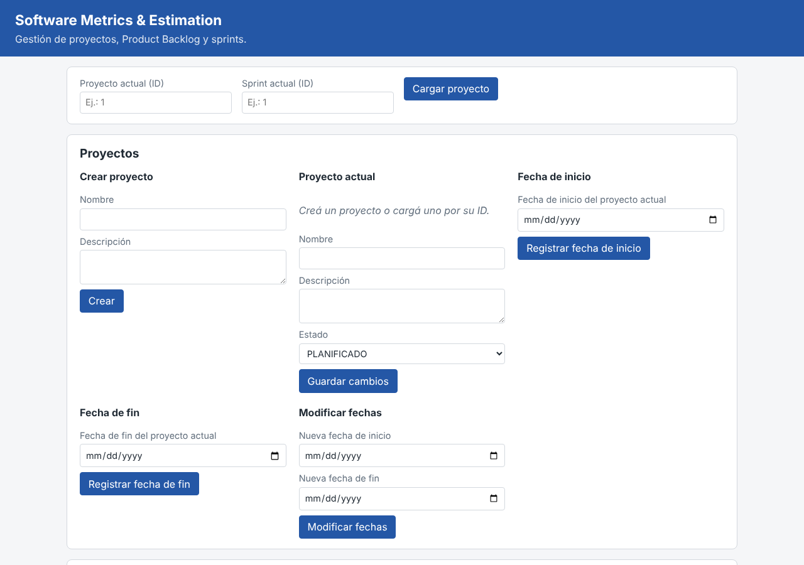

## 2. Cómo está organizada la interfaz

La interfaz es una sola página. Arriba está la barra **Proyecto actual / Sprint actual**, y debajo, una sección por tema: Proyectos, Integrantes, Product Backlog, Planning Poker, Métricas, Dashboard, Reportes, Sprints y Defectos.

- **Proyecto actual (ID):** casi todas las secciones trabajan sobre este proyecto. Se completa solo al crear un proyecto. Para volver a uno existente, escribí su ID y tocá **Cargar proyecto**: se cargan sus datos y su backlog. La aplicación no tiene un listado de proyectos, así que conviene anotar el ID de cada uno.
- **Sprint actual (ID):** lo usan "Asignar al sprint", "Completar", los reportes del sprint y la consulta de defectos por sprint. Se completa solo al crear un sprint, y también se puede elegir desde la tabla de "Ver sprints del proyecto" o escribiendo su ID.
- **Mensajes:** cada sección muestra el resultado de la última acción debajo de sus formularios. En **verde** si salió bien (por ejemplo, "Proyecto 1 creado.") y en **rojo** si la aplicación rechazó el pedido, con el motivo. En la [sección 14](#14-mensajes-de-error-comunes) están los errores más comunes y cómo resolverlos.
- **Fechas:** los campos de fecha usan el calendario del navegador; la aplicación muestra las fechas como `AAAA-MM-DD`.

Recorrido recomendado para un proyecto nuevo: crear el proyecto y registrar sus fechas → registrar los integrantes → cargar el backlog → estimar con Planning Poker → crear el sprint y asignarle ítems → pasar los ítems a `EN_CURSO`, registrar el esfuerzo y los defectos → completar los ítems y cerrar el sprint → consultar métricas, dashboard y reportes.

## 3. Proyectos (HU-01 a HU-03)

### Crear un proyecto (HU-01)

1. En **Proyectos → Crear proyecto**, escribí el **Nombre** (obligatorio y único) y, si querés, una **Descripción**.
2. Tocá **Crear**.
3. El proyecto se crea en estado `PLANIFICADO` y queda como proyecto actual. El mensaje muestra su ID: "Proyecto 1 creado.".

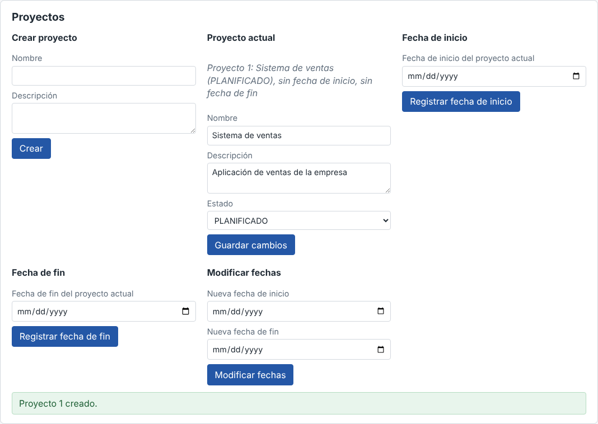

### Consultar y modificar el proyecto (HU-02 y HU-03)

1. Elegí el proyecto en **Proyecto actual (ID)** y tocá **Cargar proyecto**.
2. En **Proyecto actual** se ve el resumen: ID, nombre, estado y fechas (por ejemplo, "Proyecto 1: Sistema de ventas (EN_CURSO), inicio: 2026-10-05, fin: 2026-11-02").
3. Para modificarlo, cambiá el **Nombre**, la **Descripción** o el **Estado** (`PLANIFICADO`, `EN_CURSO` o `FINALIZADO`) y tocá **Guardar cambios**. Se guardan los tres campos juntos.

La captura de la sección siguiente muestra el proyecto ya modificado a `EN_CURSO`.

## 4. Fechas del proyecto (HU-18, HU-19 y HU-41)

Con el proyecto actual elegido:

1. **Registrar la fecha de inicio (HU-18):** en **Fecha de inicio**, elegí la fecha y tocá **Registrar fecha de inicio**. Si ya tenía una, se reemplaza. Si el proyecto tiene fecha de fin, el inicio tiene que ser anterior.
2. **Registrar la fecha de fin (HU-41):** en **Fecha de fin**, elegí la fecha y tocá **Registrar fecha de fin**. Hace falta que el proyecto tenga fecha de inicio, y el fin tiene que ser posterior.
3. **Modificar las dos fechas juntas (HU-19):** en **Modificar fechas**, que aparece completado con las fechas registradas, cambiá la nueva fecha de inicio y la nueva fecha de fin y tocá **Modificar fechas**. Solo funciona si el proyecto ya tiene las dos fechas. El fin nuevo tiene que ser posterior al inicio nuevo, sin compararse con las fechas guardadas, así que se puede postergar o adelantar el proyecto en un solo paso.

El resumen del proyecto muestra "sin fecha de inicio" o "sin fecha de fin" mientras no estén registradas.

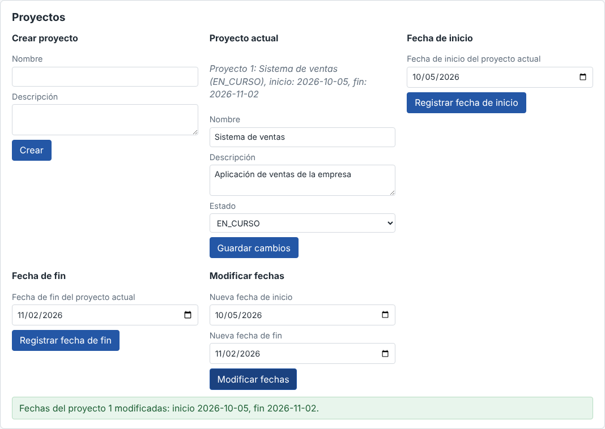

## 5. Integrantes (HU-15 a HU-17)

### Registrar un integrante (HU-15)

1. Con el proyecto actual elegido, en **Integrantes → Registrar integrante**, escribí el **Nombre** y elegí el **Rol**: Product Architect, Agile Enabler o Product Builder.
2. Tocá **Registrar integrante**. El mensaje muestra su ID: "Integrante 1 registrado: Ana Pérez (Agile Enabler).".

El nombre no se puede repetir en el mismo proyecto, sin distinguir mayúsculas y con cualquier rol. En otro proyecto sí se puede usar.

### Modificar un integrante (HU-16)

1. En **Modificar integrante**, escribí el **ID del integrante**, el **Nombre** y el **Rol** (hay que completar los dos, aunque cambie uno solo).
2. Tocá **Guardar cambios**. El integrante conserva su ID y su proyecto.

### Consultar los integrantes (HU-17)

1. Tocá **Ver integrantes del proyecto**.
2. La tabla muestra el ID, el nombre y el rol de cada integrante del proyecto actual, ordenados por ID.

La tabla no se actualiza sola al registrar o modificar un integrante: volvé a tocar el botón. En la captura, Marta Ruiz se registró como Product Builder y después se modificó a Product Architect.

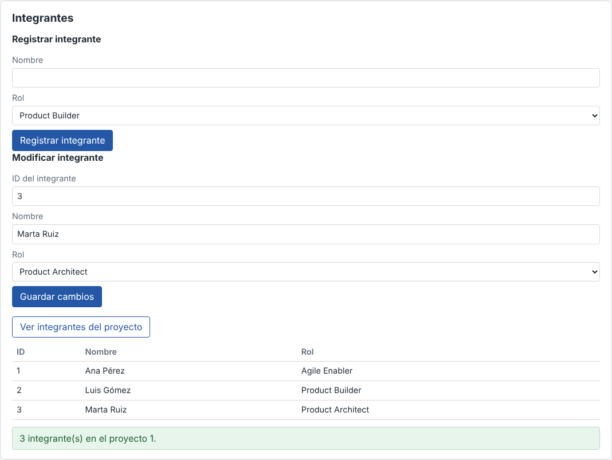

## 6. Product Backlog (HU-04 a HU-09)

### Crear un ítem (HU-04)

1. Con el proyecto actual elegido, en **Product Backlog → Crear ítem**, completá el **Título**, la **Descripción**, la **Prioridad** (`ALTA`, `MEDIA` o `BAJA`) y los **Criterios de aceptación**, uno por línea. El título y al menos un criterio son obligatorios.
2. Tocá **Crear ítem**. El ítem nace en estado `PENDIENTE` y aparece en la tabla.

### Consultar y listar los ítems (HU-05, HU-06 y HU-09)

- La tabla muestra, por ítem: ID, título, prioridad, estado, story points (**SP**, "—" si no está estimado), horas estimadas, sprint asignado ("—" si no tiene) y las acciones.
- En **Ordenar por** elegí **ID** (orden de creación) o **Prioridad** (`ALTA`, `MEDIA`, `BAJA`; a igual prioridad, por ID) (HU-09).
- **Actualizar** vuelve a leer el backlog.

### Modificar un ítem (HU-07)

1. Tocá **Editar** en la fila del ítem. Se abre el formulario **Editar ítem N** con sus datos.
2. Cambiá el título, la descripción, la prioridad, los criterios o las **Horas estimadas** (no negativas).
3. Tocá **Guardar ítem**, o **Cancelar** para descartar los cambios.

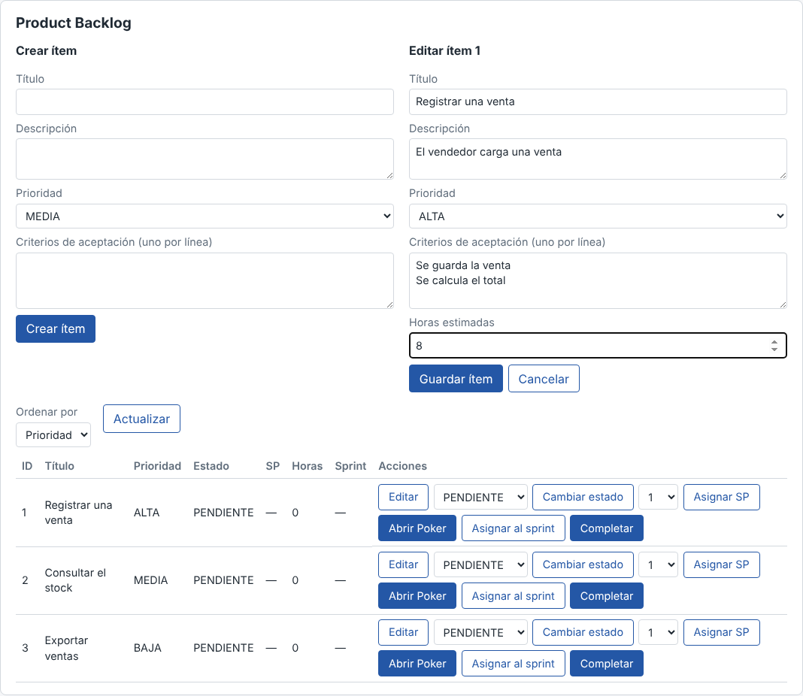

### Cambiar el estado de un ítem (HU-08)

1. En la fila del ítem, elegí el estado nuevo en la lista: `PENDIENTE`, `EN_CURSO` o `TERMINADO`.
2. Tocá **Cambiar estado**.

El estado avanza o retrocede de a un paso: `PENDIENTE` ↔ `EN_CURSO` ↔ `TERMINADO`. No se puede pasar directo de `PENDIENTE` a `TERMINADO`.

## 7. Estimación: Story Points y Planning Poker (HU-20 a HU-25)

### Asignar Story Points (HU-20)

1. En la fila del ítem, elegí un valor de la escala **1, 2, 3, 5, 8, 13 o 21**.
2. Tocá **Asignar SP**. El valor aparece en la columna **SP**.

Un ítem `TERMINADO` no se puede reestimar.

### Estimar con Planning Poker (HU-21 a HU-25)

1. **Abrir la sesión (HU-21):** tocá **Abrir Poker** en la fila del ítem. La sección **Planning Poker** muestra la sesión (ID, ítem, estado `ABIERTA` y ronda) y las cartas. Solo puede haber una sesión abierta por ítem, y no se abre para un ítem `TERMINADO`.
2. **Votar (HU-22):** cada integrante escribe su nombre en **Integrante** y toca **Votar N** con su carta. Los votos no se muestran hasta revelarlos; si alguien vota de nuevo, se reemplaza su voto.

   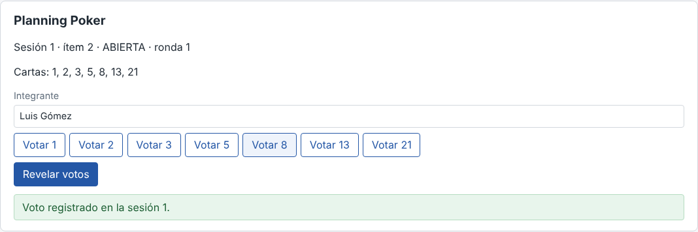

3. **Revelar (HU-23 y HU-24):** tocá **Revelar votos**. Se muestran todos los votos, la sesión pasa a `REVELADA` y no acepta más votos. Debajo se indica si todos votaron lo mismo ("Todos votaron 5.") o, si hay diferencias, el voto menor y el mayor con quién los emitió.

   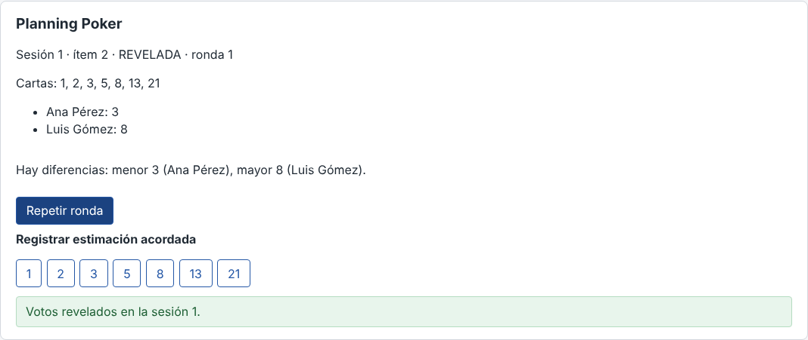

4. **Repetir la ronda (HU-24):** si el equipo quiere volver a votar, tocá **Repetir ronda**. Lo habitual es hacerlo cuando hay diferencias, pero también se puede repetir aunque todos hayan votado lo mismo. La misma sesión vuelve a `ABIERTA`, en la ronda siguiente y sin votos.
5. **Registrar la estimación acordada (HU-25):** en **Registrar estimación acordada**, tocá la carta que acordó el equipo. La sesión queda `CERRADA` y los story points se guardan en el ítem (columna **SP** del backlog).

   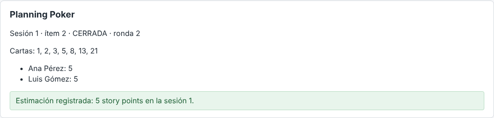

## 8. Sprints (HU-10 a HU-14)

### Crear un sprint (HU-10)

1. Con el proyecto actual elegido, en **Sprints → Crear sprint en el proyecto actual**, completá **Nombre**, **Fecha de inicio**, **Fecha de fin** (posterior al inicio) y **Sprint goal**. Todos son obligatorios.
2. Tocá **Crear sprint**. El sprint nace `ABIERTO` y queda como sprint actual. Un proyecto tiene un solo sprint abierto a la vez.

### Asignar historias y registrar las completadas (HU-11 y HU-12)

1. Con el sprint actual elegido, tocá **Asignar al sprint** en la fila del ítem del backlog. La columna **Sprint** muestra el ID. Un ítem se asigna a un solo sprint, y tiene que ser del mismo proyecto.
2. Cuando el equipo empieza a trabajar en el ítem, pasalo a `EN_CURSO` con **Cambiar estado**.
3. Al terminarlo, tocá **Completar** en su fila: pasa a `TERMINADO`. Solo se completan ítems `EN_CURSO` asignados al sprint actual, mientras el sprint está abierto.
4. En **Sprint actual**, **Ver ítems completados** lista los ítems `TERMINADO` del sprint.

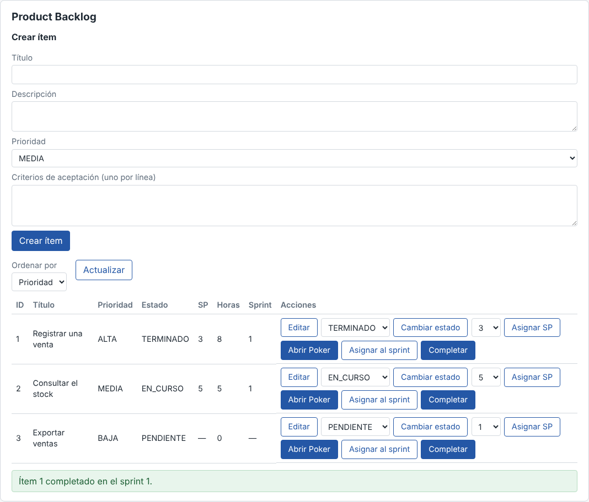

### Cerrar el sprint (HU-13)

1. Elegí el sprint en **Sprint actual (ID)**.
2. En **Sprint actual**, tocá **Cerrar sprint**. Pasa a `CERRADO`: ya no se le asignan ni completan ítems, ni se registran o corrigen esfuerzos. Después se puede crear el sprint siguiente.

### Consultar los sprints anteriores (HU-14)

1. Tocá **Ver sprints del proyecto**.
2. La tabla lista todos los sprints del proyecto actual, abiertos y cerrados, con sus fechas, sprint goal y estado.
3. **Ver ítems completados** en una fila deja ese sprint como sprint actual y muestra sus ítems completados.

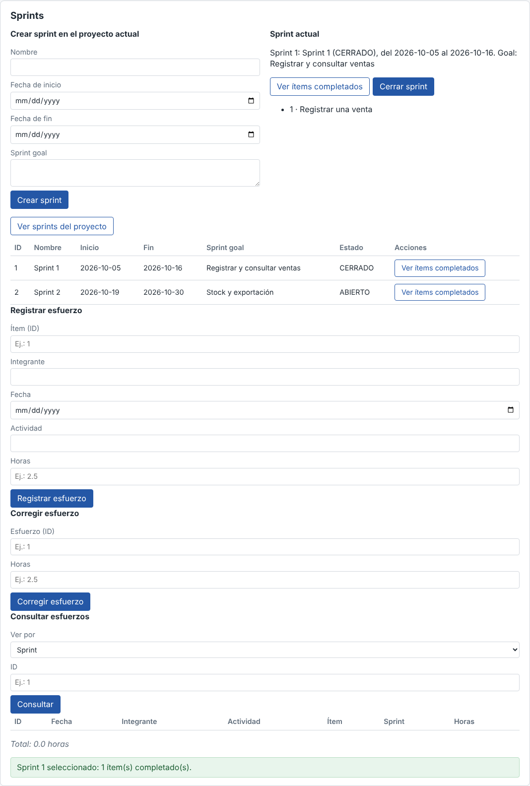

## 9. Registro de esfuerzo (HU-26 a HU-28)

Los formularios están en la sección **Sprints**.

### Registrar el esfuerzo (HU-26)

1. En **Registrar esfuerzo**, completá el **Ítem (ID)**, el **Integrante**, la **Fecha**, la **Actividad** (por ejemplo, "Desarrollo" o "Pruebas") y las **Horas** (un número positivo; se aceptan decimales, como 2.5).
2. Tocá **Registrar esfuerzo**. El esfuerzo queda en el sprint al que está asignado el ítem, que tiene que estar abierto.

### Consultar los esfuerzos (HU-27)

1. En **Consultar esfuerzos**, elegí **Ver por** **Sprint** o **Historia** y escribí su **ID**.
2. Tocá **Consultar**. La tabla lista los esfuerzos y debajo se muestra el total de horas.

### Corregir las horas de un esfuerzo (HU-28)

1. En **Corregir esfuerzo**, escribí el **Esfuerzo (ID)**, que figura en la tabla de la consulta, y las **Horas** correctas.
2. Tocá **Corregir esfuerzo**. Solo cambian las horas, y solo si el sprint del esfuerzo sigue abierto.

En la captura, el esfuerzo 2 se registró con 3 horas y se corrigió a 4.5.

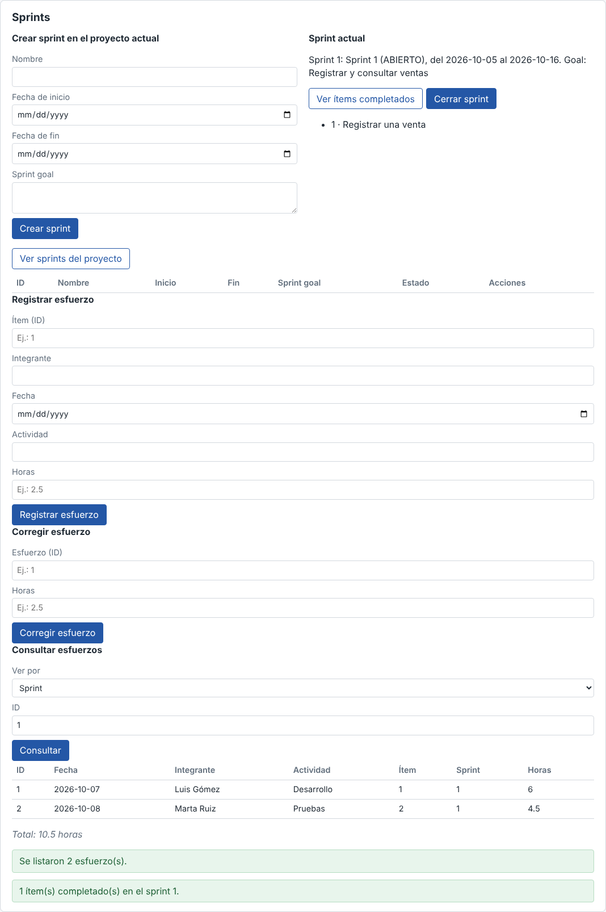

## 10. Defectos (HU-29 a HU-31)

### Registrar un defecto (HU-29)

1. En **Defectos → Registrar defecto**, completá el **Ítem (ID)** de la historia afectada, la **Descripción**, la **Severidad** (`CRITICA`, `ALTA`, `MEDIA` o `BAJA`) y el **Sprint de detección (ID)**, que tiene que estar abierto y ser del mismo proyecto.
2. Tocá **Registrar defecto**. El defecto nace `ABIERTO`.

### Cambiar el estado de un defecto (HU-30)

1. En **Cambiar estado de defecto**, escribí el **Defecto (ID)** y elegí el **Estado**: `ABIERTO`, `EN_CORRECCION` o `RESUELTO`. El estado cambia de a un paso: `ABIERTO` ↔ `EN_CORRECCION` ↔ `RESUELTO`.
2. Para `RESUELTO`, completá también el **Sprint de resolución (ID)**: tiene que estar abierto, ser del mismo proyecto y no ser anterior al de detección.
3. Tocá **Cambiar estado**.

### Consultar los defectos (HU-31)

1. En **Consultar defectos**, elegí **Ver por** **Proyecto actual** o **Sprint actual** (los detectados en ese sprint) y, si querés, un **Estado** para filtrar.
2. Tocá **Consultar**. La tabla muestra los defectos y debajo, la cantidad.

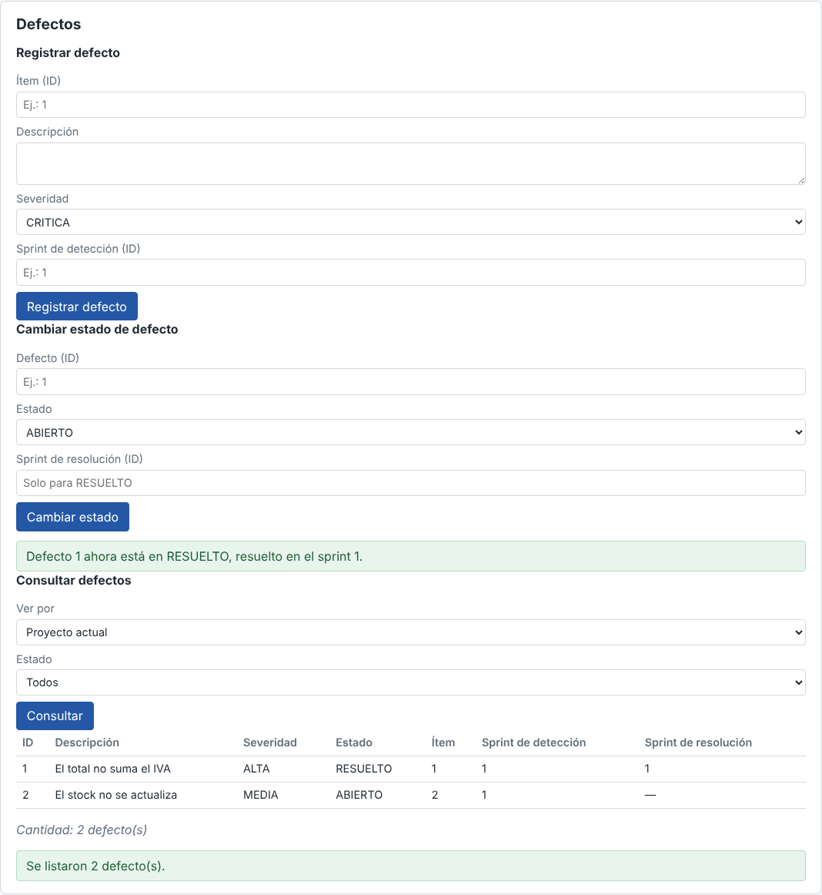

## 11. Métricas (HU-32 a HU-35 y HU-47)

1. Elegí el proyecto actual y, si querés ver también las de un sprint, el sprint actual.
2. En **Métricas**, tocá **Ver métricas**.

Se muestran, para el proyecto y para el sprint actual:

- **Story points** planificados y completados, y los ítems sin estimar (HU-32). Para el proyecto, la **velocidad**: el promedio de story points completados en los últimos 3 sprints cerrados, o en todos los cerrados si hay menos de 3 (HU-32).
- **Historias completadas:** el porcentaje de ítems terminados, con las cantidades (HU-34).
- **Horas** estimadas y reales, los ítems sin horas estimadas y la **desviación** en horas y en porcentaje (HU-33). Una desviación negativa indica que se trabajaron menos horas que las estimadas.
- **Defectos** detectados y resueltos (HU-47).

Todas salen de una sola consulta (HU-35). Si una métrica no se puede calcular (por ejemplo, la velocidad sin sprints cerrados), se muestra "sin datos". Las fórmulas están en [`docs/metricas.md`](metricas.md).

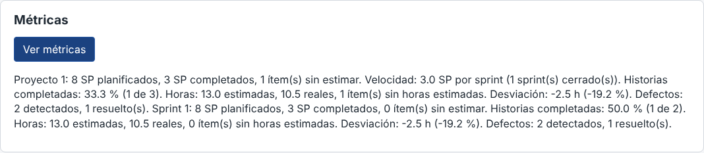

## 12. Dashboard (HU-36 y HU-37)

1. Con el proyecto actual elegido, en **Dashboard** tocá **Ver resumen** (HU-36): muestra el nombre y el estado del proyecto, la cantidad de ítems `PENDIENTE`, `EN_CURSO` y `TERMINADO`, y el sprint abierto con sus fechas y su objetivo, o "ninguno abierto".
2. Tocá **Ver gráficos** (HU-37): muestra las métricas del proyecto y tres gráficos por sprint:
   - Story Points completados por sprint cerrado, con la velocidad como línea de referencia.
   - Story Points planificados y completados por sprint.
   - Horas estimadas y reales por sprint, con su desviación.

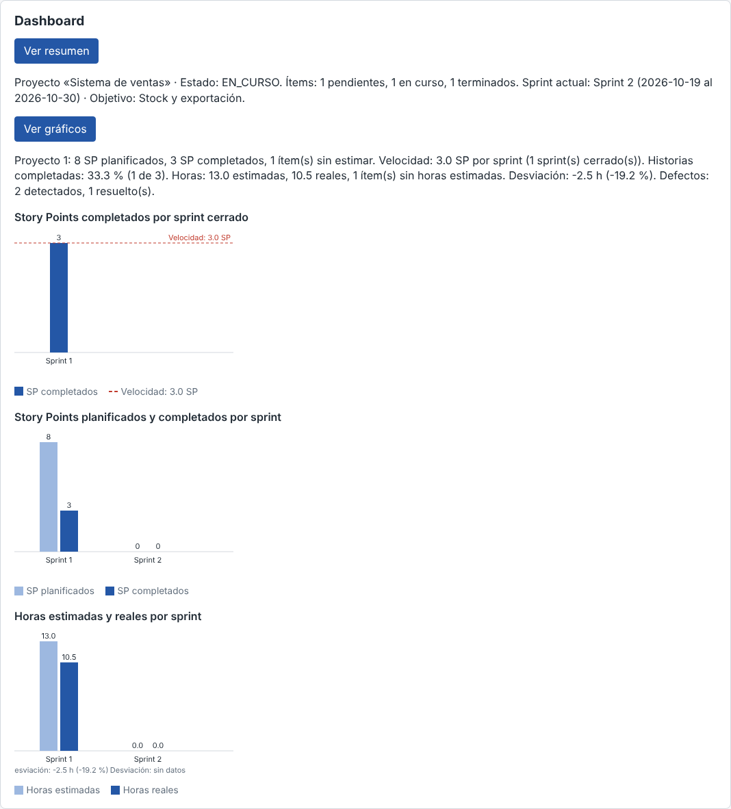

## 13. Reportes (HU-38 a HU-40 y HU-49)

1. **Reporte del proyecto (HU-38):** con el proyecto actual elegido, en **Reportes** tocá **Generar reporte**. Muestra los datos del proyecto, sus métricas, la tabla de historias, la tabla de esfuerzos con el total de horas, la tabla de defectos con la cantidad y los integrantes que registraron esfuerzo.
2. **Historias del reporte (HU-49):** la tabla de historias lista cada historia del backlog con su prioridad, su estado, sus Story Points ("—" si no está estimada), sus horas estimadas y su sprint ("—" si no está asignada). Debajo indica cuántas historias hay y cuántas están completadas (`TERMINADO`).
3. **Exportar a PDF (HU-40):** tocá **Descargar PDF**. El navegador descarga el mismo reporte del proyecto como `reporte-proyecto-N.pdf`, donde N es el ID del proyecto. El PDF incluye la sección "Historias".
4. **Reporte del sprint (HU-39):** con el sprint actual elegido, tocá **Generar reporte del sprint**. Muestra lo mismo acotado al sprint, abierto o cerrado: sus datos, sus métricas, las historias asignadas al sprint, sus esfuerzos, los defectos detectados o resueltos en él y los integrantes que registraron esfuerzo en el sprint.

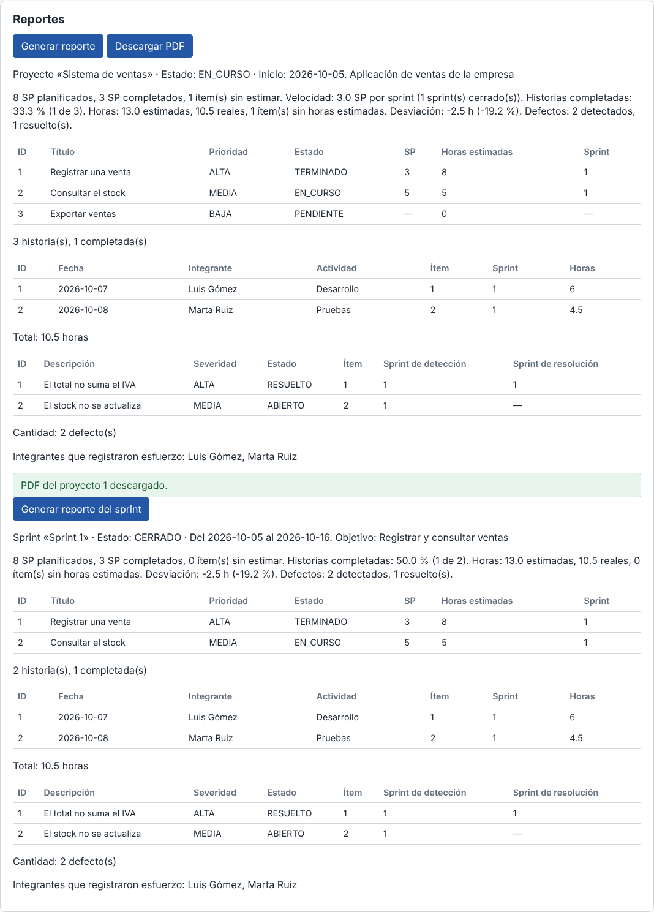

## 14. Mensajes de error comunes

Los errores se muestran en rojo debajo de la sección donde se hizo la acción. Los más comunes:

| Mensaje | Por qué aparece | Cómo resolverlo |
|---|---|---|
| No se pudo conectar con el servidor. ¿Está en ejecución? | El servidor está detenido o se reinició. | Iniciá el servidor (sección 1) y recargá la página. Con almacenamiento en memoria, los datos anteriores se perdieron. |
| Elegí un proyecto: creá uno o escribí su ID en «Proyecto actual». | La acción necesita un proyecto actual y el campo está vacío. | Creá un proyecto o escribí su ID arriba y tocá **Cargar proyecto**. |
| Elegí un sprint: creá uno o escribí su ID en «Sprint actual». | La acción necesita un sprint actual. | Creá un sprint o elegilo desde **Ver sprints del proyecto**. |
| no existe un proyecto con ese id (también ítem, sprint, defecto, esfuerzo, integrante o sesión) | El ID escrito no existe. | Revisá el ID en la tabla correspondiente. Con almacenamiento en memoria, los IDs se pierden al reiniciar. |
| ya existe un proyecto con ese nombre | El nombre del proyecto se repite. | Usá otro nombre. |
| el ítem necesita al menos un criterio de aceptación | El campo de criterios está vacío. | Escribí al menos un criterio, uno por línea. |
| la transición de estado no está permitida | Se quiso saltear un estado (por ejemplo, completar un ítem `PENDIENTE`). | Avanzá de a un paso: primero `EN_CURSO`, después `TERMINADO`. Para defectos: `ABIERTO` → `EN_CORRECCION` → `RESUELTO`. |
| ya existe un sprint abierto en el proyecto | Se quiso crear un sprint con otro abierto. | Cerrá el sprint abierto antes de crear el siguiente. |
| el sprint está cerrado | Se quiso asignar o completar un ítem, o registrar o corregir un esfuerzo, en un sprint cerrado. | Usá el sprint abierto del proyecto. |
| el ítem no está asignado al sprint | Se quiso completar un ítem de otro sprint, o registrar esfuerzo en un ítem sin sprint. | Asigná el ítem al sprint con **Asignar al sprint**, o elegí el sprint correcto. |
| ya hay una sesión de Planning Poker abierta para ese ítem | El ítem ya tiene una sesión abierta. | Seguí votando en esa sesión y revelala antes de abrir otra. |
| la sesión de Planning Poker no tiene votos para revelar | Se tocó **Revelar votos** sin votos. | Registrá al menos un voto. |
| no se pueden cambiar los story points de un ítem terminado | El ítem está `TERMINADO`. | Si hace falta reestimarlo, volvelo a `EN_CURSO` con **Cambiar estado**. |
| ya hay un integrante con ese nombre en el proyecto | El nombre se repite en el proyecto, aunque cambien las mayúsculas o el rol. | Usá otro nombre o modificá el integrante existente. |
| la fecha de fin debe ser posterior a la de inicio | Las fechas están invertidas o son el mismo día (proyecto o sprint). | Elegí un fin posterior al inicio. |
| el proyecto no tiene fecha de inicio registrada | Se quiso registrar la fecha de fin antes que la de inicio. | Registrá primero la fecha de inicio. |
| el proyecto no tiene registradas las fechas de inicio y de fin | Se usó **Modificar fechas** sin las dos fechas registradas. | Registrá cada fecha con su formulario. |
| las horas trabajadas deben ser un número positivo | Las horas están vacías, en cero o son negativas. | Escribí un número mayor que cero (se aceptan decimales). |
| el sprint de resolución es obligatorio para resolver un defecto | Se eligió `RESUELTO` sin sprint de resolución. | Completá el **Sprint de resolución (ID)**. |
| la fecha … es obligatoria (del sprint, del proyecto o del esfuerzo) | Falta una fecha o está incompleta. | Elegí la fecha con el calendario del campo. |
| Error 405 del servidor. | Quedó vacío un campo de ID de un formulario (por ejemplo, **Ítem (ID)** o **Esfuerzo (ID)**). | Escribí el ID. |
| error interno del servidor | Falla no prevista, por ejemplo la base de datos no responde. | Revisá que PostgreSQL esté levantado (`docker compose ps`) y que la terminal del servidor no muestre errores. |

Ejemplos de cómo se ven:

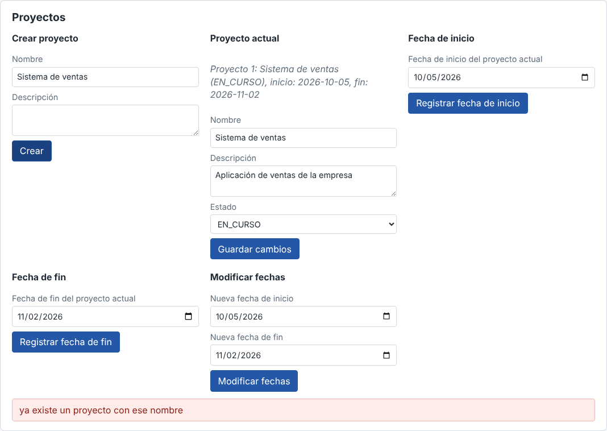

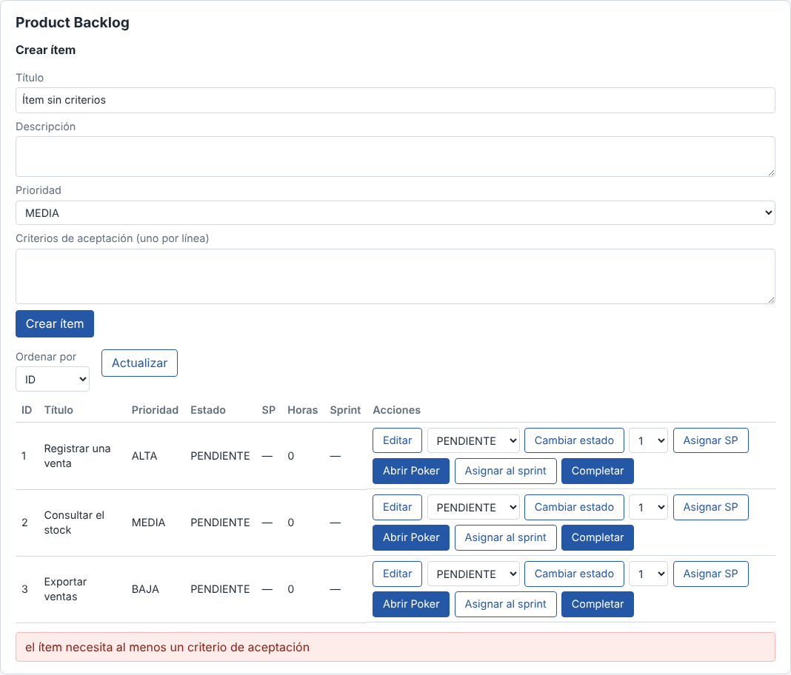

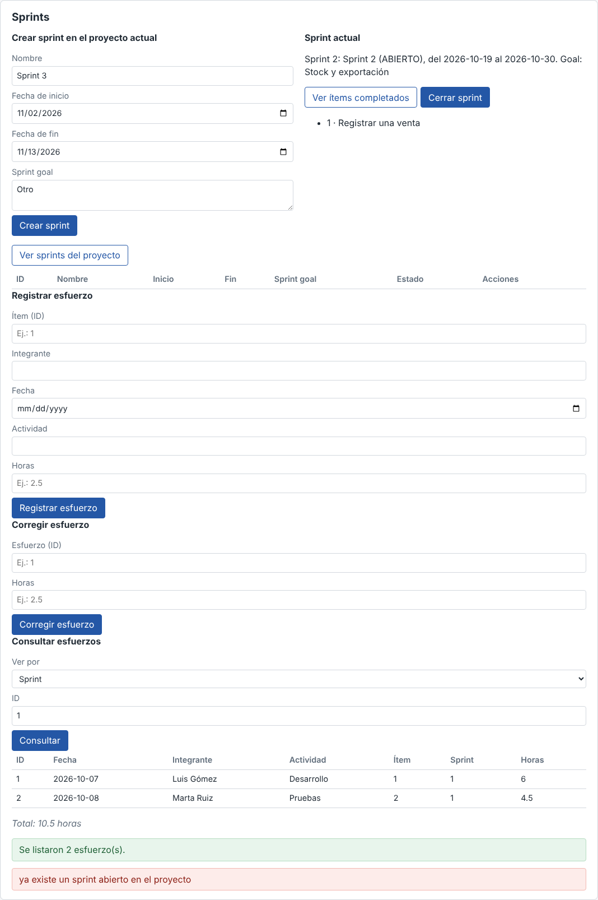

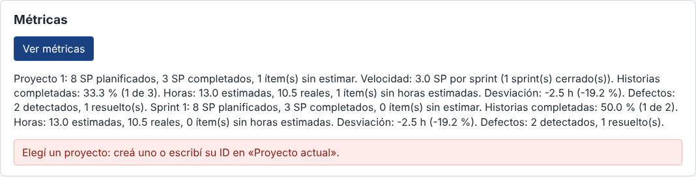

## 15. Límites de la aplicación

- No hay listado de proyectos: se eligen por su ID (ninguna historia lo pide).
- No se pueden borrar proyectos, ítems, sprints, integrantes, esfuerzos ni defectos.
- Las tablas de integrantes, sprints, esfuerzos y defectos no se actualizan solas: se vuelve a tocar el botón de consulta.
- El nombre del integrante en Planning Poker y en el registro de esfuerzo se escribe a mano y no se valida contra los integrantes registrados (HU-15 a HU-17).
- Con almacenamiento en memoria, los datos se pierden al detener el servidor.
